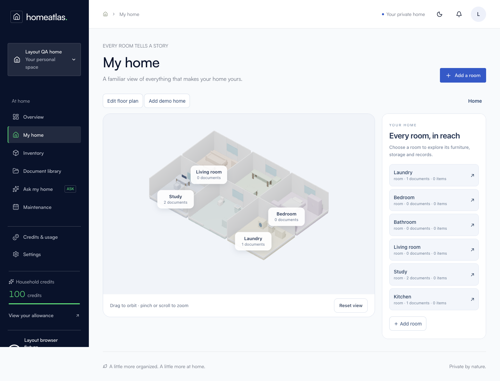
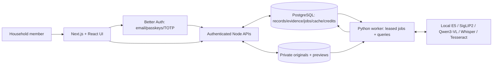
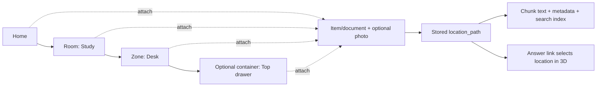
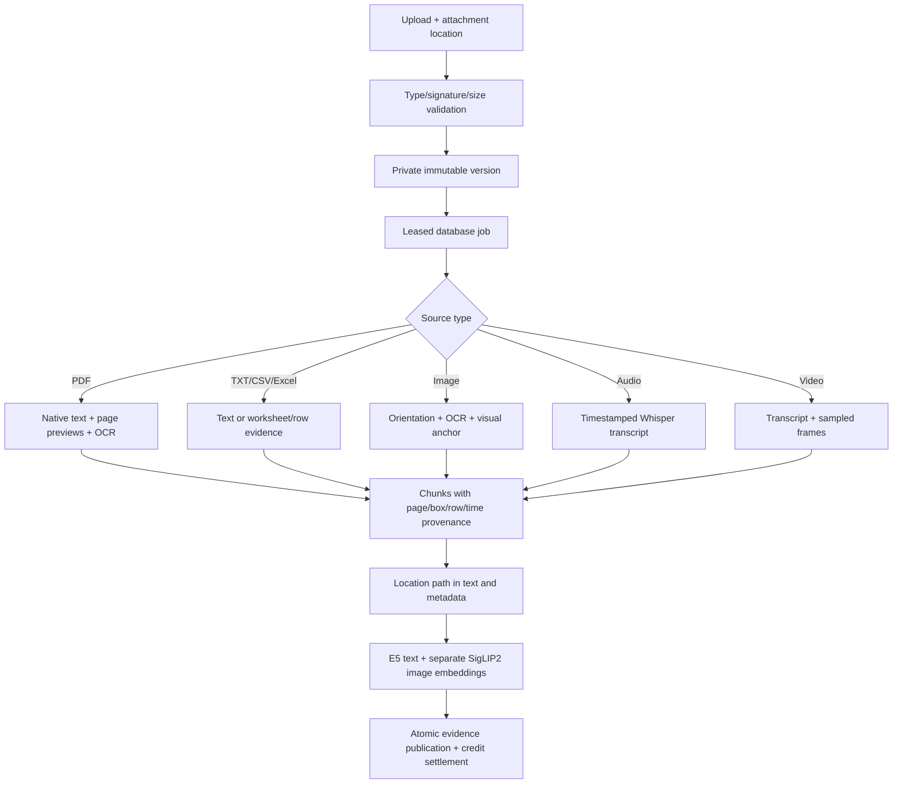
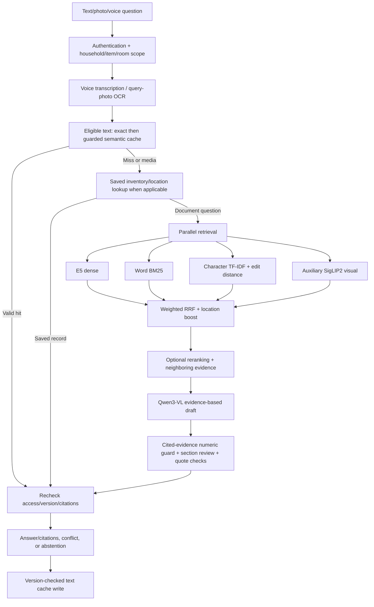

# HomeAtlas

**Your home, on the record.** A self-hosted household inventory and multimodal RAG app. Save a manual, receipt, photo, spreadsheet, or recording; record where it belongs; then search your own household evidence.

HomeAtlas combines a **Home → Room → Zone → optional Container** hierarchy, an editable **3D home**, **multilingual hybrid retrieval**, and **versioned answer caching**. Local models produce evidence-reviewed answers with links to source pages, regions, timestamps, and recorded locations.



*Existing application screenshot captured with fictional layout QA records. It illustrates the interface, not measured accuracy or performance.*

## Measured pipeline results

**Budget-limited showcase, not a complete final benchmark.** On 16 October 2026, the evaluation scope was narrowed to a focused showcase under a 30-minute completion budget. This superseded the original requirement for two complete post-fix generation passes; historical fix-log instructions retain that earlier scope. Retrieval, ingestion, household/cache, and security live probes each have two completed post-fix passes. Generation stopped at **43/60 run-1 questions**: **37 answerable / 6 negative**, with text/table/image and part of the chart set, **no scanned-PDF generation cases**, no second run, and no third-pass sample. The prefix is deterministic, not randomly sampled.

Scores/rates below use [0,1]; review means use the stated half-credit rubric, and lower CER/WER/persistence are better. Arrows compare the same component metric with its frozen baseline. CIs are 95% empirical bootstrap intervals. `n` counts distinct questions/probes, not doubled observations. Small or degenerate intervals do not establish population guarantees. Values are formatted from the [canonical showcase results](evaluation/showcase_results.json); full precision, per-run values, source bindings and CI methods are in the [concise report](evaluation/RAG_EVALUATION_REPORT.md).

| Metric family | Measured result | Scope and limitation |
| --- | --- | --- |
| Retrieval coverage @5 | 0.975207 → **0.983471**, CI [0.958678, 1] | 121 answerable questions; two passes. Relevant-page/chunk hit, not answer accuracy. |
| Strict chunk Recall@5 | 0.8323 → **0.804924**, CI [0.744146, 0.863292] | 121 questions; two passes. **Declined**, along with Precision, MRR and NDCG below. |
| Typo / Hinglish MRR@5 | Hybrid **0.965789**, CI [0.910526, 1]; fuzzy-only **1**, CI [1, 1] | 38 questions; two passes. Strict hybrid-superiority target **not met**. |
| Recorded locations | Full-path rate **1**, CI [1, 1] | 20 location queries; two passes. Container accuracy covers only one container case. |
| Aggregate answers | Required-fact presence 0.333333 → **0.666667**, CI [0, 1] | 3 queries; two passes. Receipt-total answer omits the requested calculated total; fact presence is not completeness. |
| Semantic cache / freshness | Variant hits **0.8**, CI [0.5, 1]; near-miss false hits **0**, CI [0, 0]; move/delete invalidation **1**, CI [1, 1] | 10 variants / 10 near-misses / 2 mutations per pass. Variant-hit target 0.90 **not met**; zero observed false hits is not a population guarantee. |
| Multimodal parsing | OCR CER **0.00337838**, CI [0, 0.0101351]; WER **0.0217391**, CI [0, 0.0652174]. Chart numeric-label recall **0.75**, CI [0.5, 1]. PDF structured-table output **0**, CI [0, 0] | 4 clean synthetic scan pages / 12 chart labels / 4 table pages; two passes. Not real-phone-photo accuracy, chart reasoning, or table-cell structure accuracy. |
| Identifier-cache policy | Sensitive-answer persistence 1 → **0**, CI [0, 0] | One synthetic canary per pass. Narrow recognized-identifier bypass; not universal PII protection. |
| Partial citation provenance | Gold citation precision **0.936937**, CI [0.867117, 0.986486]; strict gold-chunk recall **0.585023**, CI [0.446481, 0.722973] | 37 answerable questions in one stopped prefix. Source relevance/provenance, **not independently judged factual accuracy**; no baseline comparison. |
| Independent Codex answer review | Answerable correctness mean **0.824324** (n=37); faithfulness **0.972222** (n=36); relevancy **0.851351** (n=37); explicit unsupported-claim flags **2/43** | One synthetic 43/60 stopped prefix, no scanned questions. Separate Codex rubric review, exact model ID unavailable; not RAGAS, human review, calibrated inter-rater testing, or production validation. No review CI claimed. |
| Partial observed latency | p50 **94.8424 s**; p95 **162.591 s** | 43 saved queries, one prefix. Shared-host in-process wall time includes waits; not HTTP latency or an SLA. No latency CI is claimed. |

**Independent review scope:** correctness uses a 0 / 0.5 / 1 rubric, not a binary accuracy percentage: 30 fully correct, 1 half-credit, and 6 zero-credit answers among 37 answerable questions. The 6/6 appropriate negative abstentions are separate. Faithfulness excludes 7 non-substantive refusals; relevancy excludes 6 appropriate negative abstentions. Image-question correctness mean is **0.65** (n=10), and chart-question correctness **0.714286** (n=7), preserving the observed visual-answer weaknesses. Three Codex assignments reviewed saved answers against source evidence; no new application inference, human adjudication, baseline semantic-improvement claim, or full-suite generalization is implied. [Dedicated independent review and provenance](evaluation/INDEPENDENT_JUDGE_REVIEW.md) · [Detailed report](evaluation/RAG_EVALUATION_REPORT.md#independent-codex-review-of-saved-answers).

**Ranking tradeoffs:** Precision 0.338843 → 0.287603; MRR 0.930854 → 0.92011; NDCG 0.8955 → 0.855013 (n=121 per pass); all declined. Better hit rate did not improve every retrieval measure.

**Additional scope checks:** source-value presence was 1 for identifiers (n=3), 1 for dates (n=2), and 1 for amounts (n=2), in each component pass; these are literal required values, not automatic extraction accuracy. Table cell-text recall was 1 (n=48), despite missing structured PDF tables. Exact cache hits were 1 (n=5 per pass); strict semantic guards still missed variants.

**Partial answers and security:** exact-quote validity was 1 only among n=36 answers with citations; abstention recall was 1 on n=6 negatives, and false-refusal rate 0.027027 on n=37 answerable questions. These are not full-suite accuracy. Both live security runs passed **24/27 probes**; three frozen cache-retention assumptions fail after deliberate identifier-cache bypass. Empty-cache checks do not prove populated-cache isolation. A separate populated non-sensitive cache regression has a different scope.

**NOT MEASURED:** formal external-API/RAGAS LLM-judge scores, semantic context precision@5/recall, counted-claim citation precision/recall, inter-rater calibration; full final generation variance/three-pass consistency and final similarity postprocessing (budget stop); scanned-PDF generation; numeric trust calibration; HTTP timeout rate, production capacity/cost, and isolated 3D FPS. The bounded Codex review above is separately named and does not fill those protocol gaps. No canonical complete `final_results.json` was created. The [baseline snapshot](evaluation/baseline_results.json) and [historical metric CSV](evaluation/stats-metric-scorecard.csv) remain available; they are historical evidence, not current full-generation results.

The report includes the [complete requested-metric inventory](evaluation/RAG_EVALUATION_REPORT.md#requested-metric-coverage), [retrieval by modality](evaluation/RAG_EVALUATION_REPORT.md#retrieval-by-modality-at-k5), and [partial generation by modality](evaluation/RAG_EVALUATION_REPORT.md#generation-by-modality--stopped-run-1-only) for text, tables, images, charts, and scans. Context precision/recall, formal RAGAS judge scores, scanned generation, and currency cost remain explicitly **NOT MEASURED** with reasons. The separately labeled Codex correctness/faithfulness/relevancy and unsupported-claim judgments cover only saved answers; they are not inferred from source overlap or literal labels and do not establish general image understanding.

## Features

### Inventory and document library

- **Inventory:** create/edit items with a room, category, brand, model, serial number, purchase date, warranty end date, and notes. Search by name and filter by room; keep an item's documents and maintenance history together.
- **Saved facts:** supported serial-number, model, brand, date, category, and notes questions read matching inventory fields directly, without OCR. Conflicting saved values are shown explicitly. This is separate from automatically extracting fields from an upload.
- **Recorded locations:** supported English/Hinglish location questions and document aliases return the stored full path and a **Show location in 3D** link. The app reports where you recorded an object; it cannot detect physical movement.
- **Source lifecycle:** upload a new source or immutable version, inspect queued/processing/ready/failed status, retry/reprocess, open originals, preview PDF pages or extracted text, and move/delete documents from the location panel.
- **Photos:** associate an uploaded image with an item/document or keep it directly at a location.

### Home hierarchy and 3D editor

- **Precise attachments:** items/documents can belong to the home, a room, a furniture/area zone, or a drawer/shelf/box container. Paths such as `Study > Desk > Top drawer` are stored with records and included in chunk text and metadata. Existing room attachments remain supported.
- **Data-driven scene:** pastel floors, rounded low-poly furniture, subtle shadows, door/window openings, screen-aligned labels with collision hiding, hover counts, orbit/pan/zoom, and reset view.
- **Click/tap to explore:** room camera transitions, cutaway walls, clickable zones/containers, breadcrumbs/back navigation, descendant record counts, and a details panel. Answer links select and briefly highlight the recorded location.
- **Top-down layout editor:** grid snapping, add/resize/move/rotate rooms and furniture, rename/recolor nodes, edit doors/windows, and mark attached storage/washrooms. Numeric controls support keyboard/mobile editing.
- **Furniture presets:** bed, sofa, table, chair, desk, wardrobe, cabinet, TV unit, counter, fridge, washing machine, toilet, sink, window, door, storage/washroom areas, drawer, shelf, and box.
- **Demo home:** furnished living, kitchen, bedroom, study, bathroom, and laundry spaces with clearly labeled fictional sample documents. Ordinary retrieval excludes samples unless the query requests them.
- **Responsive access:** light/dark themes, reduced-motion behavior, and a navigable location list if WebGL is unavailable or lost. No frame-rate guarantee is claimed.

### Multimodal questions and grounded answers

- **Ingestion:** native PDF text, OCR for scans/photos and substantial embedded PDF images, UTF-8 text/CSV, Excel worksheet values, local audio transcription, and sampled video frames. Format/decoder limits are documented below.
- **Parallel text retrieval:** multilingual E5 dense similarity, word BM25 over PostgreSQL lexical candidates, and character n-gram/edit-distance fuzzy matching, fused by weighted reciprocal rank fusion (RRF).
- **Visual retrieval:** separate SigLIP2 image/text embeddings provide auxiliary candidates for text and photo questions. Repeated OCR chunks share one representative visual candidate per source/version/page, preserving other evidence in the shortlist. Similarity proposes evidence; it does not establish an answer's correctness.
- **Typo/Hinglish support:** Unicode/lowercase/punctuation normalization, repeated-letter handling, editable household/Indian-document aliases, fuzzy matching, and low-score spelling suggestions. Named paths boost relevance; explicit item/room scopes filter results.
- **Optional reranker:** a local cross-encoder can rerank fused candidates behind a flag. It is disabled by default; evaluation must justify enabling it.
- **Photo and voice input:** attach a photo, record a browser voice note, ask from a recording, or save the recording to the library. Voice questions use local Whisper. Microphone recording requires permission and HTTPS or localhost.
- **Detailed explanations:** Qwen3-VL reads retrieved text and source images; a separate call to the same local Qwen model checks support and question responsiveness, including concise extractive fallbacks. Review uses each section's cited evidence rather than unrelated generated quotes/images; final citations retain only accepted sections' references. This is not an independent external judge. Answers render sanitized Markdown, tables, highlighted code, and KaTeX math, with a copy action and query-term highlights outside code/math. Evidence stays in collapsible, deduplicated source cards with sentence-bounded snippets, distinct clickable citation chips, original-page links, and 3D location links. Uncertain PDF equations can show a crop of the cited page rather than guessed notation.
- **PDF text cleanup:** new ingestion joins wrapped and hyphenated lines, normalizes ligatures/spacing, and retains raw text and page coordinates for source links. The answer-cache format version changed. Existing PDFs need reprocessing to gain the cleaned index; the [scoped reindex utility](worker/reindex_clean_pdf.py) defaults to a dry run and requires an exact source ID for an applied change.
- **Text-only numeric guard:** before model review, numeric literals/identifiers in both the rendered heading and body must occur in that section's own referenced text, with bounded formatting normalization. Malformed non-string headings/bodies fail closed. Unsupported new numeric values are rejected; unverified arithmetic can abstain. Referenced visuals bypass the literal-coverage check because image facts may be absent from OCR, while field-type validation still applies. Literal coverage does not establish correct object/value pairing, units, dates, or spelled-out-number truth.
- **Canonical citations:** exact quotation and source/version checks, PDF page/region previews, worksheet/row references, media timestamps, and location links. These establish provenance, not that every synthesized claim is true.
- **Answer states:** supported, conflicting, extractive/direct evidence, and insufficient-evidence/abstention states. These are categorical labels, **not calibrated trust probabilities**.
- **Bookmarks:** private saved searches/answers with citations and location references; editors can save an answer into shared item history. Saved location references refresh against current records.

### Cache, collaboration, and operations

- **Exact → semantic → full lookup:** eligible text queries use normalized exact cache, then embedding similarity with key-term/number/intent/location guards, then saved-record lookup or hybrid RAG. Media and recognized personal-card identifier requests bypass cache. Identifier-bearing answer/citation/fact content is also blocked from optional cache writes; this is a conservative rule, not universal PII detection.
- **Invalidation:** cache scope includes household **and user**, query scope, configuration, and household data version. Mutations invalidate older generations; current citation/source/path checks run again before reuse.
- **Cache controls:** configurable TTL, short negative-answer TTL, LRU bounds, request bypass, owner-only metrics, **Settings → Clear answer cache**, and an owner-only DELETE API. The button now sends the correct transport method. Recognized sensitive legacy entries are pruned in the authenticated cache scope; deployment should purge the old ephemeral cache once. Guard rejection rate is distinct from measured false-hit rate.
- **Authentication:** verified-email/password sign-in, password reset, passkeys, authenticator TOTP/recovery codes, session review, revoke other sessions, and sign-out. Development has a password-protected local verification-email helper; deployment uses SMTP.
- **Households:** multiple-household selection, owner/editor/viewer roles, email-bound expiring invitations, member role changes/removal, and last-owner protection.
- **Maintenance:** one-time/recurring reminders, calendar view, completion history, upcoming-task indicators, and activity trail. Reminders appear in-app; scheduled maintenance emails are not implemented.
- **Credits:** internal allowances/monthly grants, atomic reservation/charge/refund, idempotent operations, append-only ledger, and CSV export. No payment service is integrated.
- **Owner tools:** job/worker health, failures and attempts, usage/audit views, household JSON export, and confirmed deletion. Export omits private file paths/vectors; original files must be downloaded separately.
- **Private operation:** authenticated range-capable file streaming, private originals/previews, leased PostgreSQL jobs with retry/reclaim handling, health endpoints, and local inference without a hosted-model requirement.

The [source-backed feature inventory](evaluation/results/docs-agent.json) lists implementation evidence and known qualifications. Implemented features and measured reliability are separate; see [limitations](#limitations).

## What the evaluation changed

- Deduplicated repeated visual-page candidates, added exact-number unions for multi-record comparisons, and handled warranty/expiry query morphology. Strict chunk ranking and page-level hit rate are separate outcomes; the measured tradeoffs remain visible in the report.
- Removed unused quote/image context from review and unused final citations; added same-Qwen responsiveness checks and bounded numeric-literal coverage over rendered headings/bodies. Literal presence does not validate object/value pairing, visual numbers, or arithmetic absent from the source.
- Repaired the Settings cache-clear HTTP method, added bounded SHA256 hashing, and bypassed recognized personal-card identifiers in optional answer caching with legacy pruning. This is not universal PII detection.

The latest Python regression run passed **114 tests**, including disposable database fixtures. The preceding **87 JavaScript tests** and TypeScript check passed; no TypeScript code changed in the last heading patch, so those are earlier applicable checks, not fresh reruns. Earlier counts and the database subset overlap these suites and are not additive. [Fix details and controlled tests](evaluation/CHANGELOG.md) · [recorded commands](evaluation/results/fixer-agent.json).

## How it works

Next.js owns authentication, authorization, APIs, and UI. PostgreSQL stores records, evidence/search indexes, cache, jobs, and accounting. A private filesystem holds immutable originals/previews. The Python worker extracts/indexes evidence and calls local models.









Photo queries bypass direct saved-record matching. Media and recognized personal-card identifier requests bypass answer caching. Each ask is independent; stored conversation rows currently do not provide follow-up context.

## Stack and models

Versions below resolve from [package-lock.json](package-lock.json) and [worker/requirements.lock.txt](worker/requirements.lock.txt). Model identities/dimensions are checked before vector comparison.

| Component | Implementation |
| --- | --- |
| Web | Next.js 16.4.0, React 19.3.0, TypeScript 7.0.2 |
| Authentication | Better Auth 1.7.7, passkey and two-factor plugins |
| 3D | Three.js 0.186.1, React Three Fiber 9.8.1, Drei 10.7.9 |
| Database | PostgreSQL; `vector`, `pg_trgm`, `fuzzystrmatch`, ICU collation required; Compose uses pgvector/PostgreSQL 16 |
| Worker | Python, FastAPI 0.115.12, Uvicorn 0.34.0, Psycopg 3.2.6 |
| Parsing/media | PyMuPDF 1.25.5, Pillow 11.1.0, Tesseract/pytesseract 0.3.13, FFmpeg/FFprobe |
| Inference | Local Ollama, PyTorch 2.7.0, Transformers 4.57.3, NumPy 1.26.4 |
| Storage/queue/cache | Private filesystem + PostgreSQL; no Redis or object-store requirement |

| Purpose | Model | Pin |
| --- | --- | --- |
| Multilingual text embeddings | `intfloat/multilingual-e5-small` | `614241f622f53c4eeff9890bdc4f31cfecc418b3` |
| Image/text embeddings | `google/siglip2-base-patch16-224` | `75de2d55ec2d0b4efc50b3e9ad70dba96a7b2fa2` |
| Optional cross-encoder | `BAAI/bge-reranker-base` | `2cfc18c9415c912f9d8155881c133215df768a70` |
| Generation + section review | Ollama `qwen3-vl:4b-instruct` | Record actual artifact digest per run/release; the tag is mutable |
| Transcription | Local Whisper `tiny` | `openai-whisper==20250625`; weight download is hash-checked |
| OCR | Installed Tesseract English/Hindi packs | `OCR_LANGUAGES=eng+hin`; installed packs only |

Downloads are explicit setup operations. Runtime uses local HF snapshots and the configured Ollama endpoint. Keep that endpoint private/local for this privacy profile. [worker/config.py](worker/config.py) and [.env.example](.env.example) define current defaults; [older model notes](docs/MODELS.md) describe historical BGE-small experiments and must not be read as the current E5 configuration.

## Upload formats and limits

| Format | Evidence retained | Qualifications |
| --- | --- | --- |
| PDF | Text, page images, OCR, page/region coordinates | No dedicated semantic table/figure/chart parser |
| UTF-8 `.txt` | Text chunks | Binary/non-UTF-8 rejected; `.docx` is not supported |
| UTF-8 `.csv` | Parsed rows with row references | Textual evidence, no spreadsheet computation |
| `.xlsx`, `.xlsm` | Stored worksheet values, sheet/row references | Formulas/macros are not executed; convert legacy `.xls` to `.xlsx` |
| Raster images | OCR, original image, visual embedding | PNG/JPEG/WebP/GIF/BMP/TIFF/ICO and additional Pillow-decodable rasters; decoder availability varies; not all animation frames; SVG/HEIC not promised |
| Audio | Transcript and segment timestamps | WAV/MP3/FLAC/AIFF/Ogg/M4A/WebM and validated FFmpeg-decodable audio; codec availability and speech clarity matter |
| Video | Transcript + sampled frame evidence | MP4/WebM/MKV/AVI when FFmpeg can decode them; brief events can be missed |

Default bounds: **50 MiB/upload**, **250 PDF pages**, **40 megapixels/image**, **900 seconds/media file**, and at most **30 sampled video frames**. These are configuration/code limits, not measured throughput. See [validation](lib/storage.ts), [settings](worker/config.py), and [extraction](worker/ingestion.py). A broad file picker does not guarantee every selected format/codec is decodable.

## Run locally

Install Node.js 22.16+ and npm, **Python 3.12**, PostgreSQL command-line tools with pgvector/pg_trgm/fuzzystrmatch and ICU support, FFmpeg/FFprobe, Tesseract with required language packs, and [Ollama](https://ollama.com/). Start Ollama first. Allow several GB of model storage and enough RAM for local inference; shared model loading can be slow.

1. Clone and start native development:

```sh
git clone https://github.com/RahulAdyaa/HomeAtlas.git
cd HomeAtlas
npm run setup
```

Setup installs locked dependencies, creates `.env.local` with fresh local secrets if absent, initializes the loopback development database on port 54329, applies migrations, and starts worker/web services. It preserves existing local data/config. The first font setup downloads Satoshi assets. Install missing PostgreSQL extensions/ICU before migration.

2. In a second terminal at the repository root, install models:

```sh
bash scripts/models.sh
```

3. Open [http://localhost:3000](http://localhost:3000), register, and verify your email. Locally, enter your email/password in the sign-in form and choose **Open verification email**. Create a household, add an item/layout, upload a fictional record, wait for **Ready**, then ask. **My home → Add demo home** supplies labeled sample documents; include `sample` in a question to retrieve those records.

`npm run setup` stays in the foreground. Ctrl+C stops web and a worker it started; PostgreSQL persists. To stop the owned database separately:

```sh
pg_ctl -D .data/postgres stop
```

The development database uses loopback/trust authentication for one trusted computer. Do not expose it publicly. Keep `.env.local`, `.data/`, weights, virtual environments, and private uploads untracked.

### Email and updates

Development verification/reset/invitation messages use private local mail files when SMTP is absent and local mail is enabled. The password-protected verification helper is development/loopback only. For deployment, configure SMTP using [.env.example](.env.example), set `ALLOW_LOCAL_MAIL=false`, and set the final HTTPS `BETTER_AUTH_URL`; passkey origin/RP ID derive from it.

For an existing installation:

```sh
node --env-file=.env.local --import tsx scripts/backend-migrate.ts
worker/.venv/bin/python -m worker.download_models --text --image --whisper
```

Remove obsolete text-model overrides or use the pinned E5 model/revision, then restart the worker. Background rebuilding updates incompatible text vectors; lexical search remains available. Switching model families requires reindexing and evaluation.

## Tune retrieval and cache

Edit [retrieval settings](config/retrieval.json) and [aliases](config/search-aliases.json). Normalization applies at query/index time; it preserves numbers, performs NFKC/lowercase/punctuation handling, and collapses alphabetic runs longer than two characters before alias matching.

```text
RRF(chunk) = sum(channel_weight / (rrf_k + rank_in_channel))
```

Defaults: `rrf_k=60`, `channel_top_k=30`, `top_n=5`, equal weights, reranker off. Larger `rrf_k` compresses rank-position differences. Tune against held-out questions rather than assuming fusion/reranking must outperform a single channel. PostgreSQL shortlists with `ts_rank_cd`/trigrams before BM25/fuzzy rescoring; this is not native full-corpus BM25. Dense distance is exact within authorized compatible evidence; ANN indexes are not implemented. Rerun migrations after alias edits and restart the worker.

Named paths boost relevance; explicit room/item selections remain filters. Single identifiers/multipart numbers retain exact token requirements. Explicit comparisons and supported multi-unit phrasing use a union of exact numeric tokens to retrieve separate named records; this fixes a prior all-tokens-in-one-chunk failure without fuzzy-matching a different number. Text-cache defaults: similarity `0.93`, TTL `604800` seconds, insufficient-answer TTL `300` seconds, `500` entries per household/user with LRU eviction. Source/item/location/chunk mutations increment the household version. Hits check key terms and current references/paths.

Send `bypassCache: true` to `POST /api/ask` with a **new** `operationId`; idempotent replay returns its original result. Owners can inspect `GET /api/cache`, use **Settings → Clear answer cache**, or call `DELETE /api/cache` using the household selector/header. Recognized personal-card identifier queries/answers bypass optional caching; ordinary eligible questions can still retain private query/answer content. Arbitrary names, addresses, and every international identifier format are not guaranteed to be detected. Guard rejection rate is not observed false-hit rate.

## Run tests and evaluation

With app/database running and models installed:

```sh
npm run typecheck
node --env-file=.env.local node_modules/vitest/vitest.mjs run
HOMEATLAS_DB_TESTS=1 worker/.venv/bin/python -m pytest tests -q
npm run build
```

Browser checks need Playwright Chromium (`npx playwright install chromium`) or a compatible `PLAYWRIGHT_EXECUTABLE_PATH`:

```sh
node scripts/journey.mjs
node scripts/journey-mobile.mjs
npm run qa
node scripts/passkey-check.mjs
```

Journeys use fictional accounts/households; their credentials/session files stay in ignored `.data/`. They do not verify every physical passkey device or deployment.

<!-- EVALUATION_COMMANDS_START -->
The saved-results summary can be rebuilt without new inference:

```sh
evaluation/.venv/bin/python evaluation/showcase/report.py --app-root "$PWD"
```

This reads existing observations and writes the showcase summary/report. It does not complete the stopped benchmark or produce a complete `final_results.json`.


Set up the isolated evaluation environment after installing the application/system prerequisites and pinned models:

```sh
python3.12 -m venv evaluation/.venv
evaluation/.venv/bin/python -m pip install -r evaluation/requirements.lock.txt
evaluation/.venv/bin/python -m pip install -r evaluation/requirements-metrics.txt
export EVAL_APP_ROOT="$PWD"
export MODEL_DIR="$PWD/data/models"
export EVAL_SHARED_RUNTIME="$PWD/evaluation/runtime"
export EVAL_PYTHON="$PWD/evaluation/.venv/bin/python"
python evaluation/run_eval.py --dry-run --phase final
python evaluation/run_eval.py --phase final
```

Optional full reproduction: on the current post-fix checkout, `--phase final` requests both independent final passes and assembles statistics. This can run for hours and is separate from the recorded budget-limited showcase. The runner defaults to `baseline`; reproducing the frozen pre-fix baseline requires its recorded application source. It uses disposable fictional accounts/documents in the development database, with model work serialized where needed; customer documents are not the corpus. Resume is limited to the same source/data/phase/run identity, and a second run cannot reuse the first run's generated answer.

```sh
python evaluation/run_eval.py --phase final --group retrieval
python evaluation/run_eval.py --phase final --group A --group G
python evaluation/run_eval.py --phase final
python evaluation/run_eval.py --check --phase final
```

`--group` supports specialist names or A–L; the final phase requires both complete post-fix passes from every specialist. If using `--app-root`, set `EVAL_APP_ROOT` to that same directory and keep model/runtime/interpreter variables consistent; the frozen runner does not override a conflicting exported value. `--aggregate-only` reads existing observations and is not a new inference run. A partial suite fails completeness checks and does not become a frozen snapshot. Input/app hashes and immutable aggregate snapshots reject an incompatible summary, but specialist dispatch writes raw result files before aggregation. Do not dispatch the baseline phase into published results on a fixed checkout. Historical reproduction needs a separate matching application checkout, development database, runtime, raw-results directory, and disposable artifact copy; preserve the sealed original baseline and raw records. See [evaluation setup/options](evaluation/README.md) and [contract](evaluation/CONTRACT.md). Independent verification has checked clean-archive CLI/preflight behavior; a fresh dependency install plus full inference from a clean machine has **not** been established.
<!-- EVALUATION_COMMANDS_END -->

## Share or deploy

The complete configuration needs persistent PostgreSQL, private files shared with a long-running Python worker, and local model inference. **Vercel alone cannot run this complete configuration.** The included deployment path is a self-hosted server/VM with Docker Compose and an HTTPS reverse proxy. Splitting web hosting requires deliberate networking/storage integration.

Copy [.env.example](.env.example) to `.env`, replace every secret placeholder, configure SMTP/final HTTPS origin, install host model artifacts, then:

```sh
docker compose up --build -d
```

Compose publishes web on loopback port 3000; keep database/worker/Ollama private. Configure proxy upload/time limits, consistent database/file backups, and a constrained DB role. Verify auth/media access at the deployed origin. See [deployment, backup/restore, rollback](docs/DEPLOYMENT.md); container/public deployment is separate from native evaluation.

## Limitations

- **Grounding is not certainty:** quote checks establish provenance; model explanations, OCR, and visual interpretations can be wrong. The text-only numeric guard checks rendered headings and bodies and rejects malformed field types. It blocks unsupported literals, not incorrect object/value associations, units/date meaning, every spelling/format, or referenced visual numeric claims. Unverified derived numbers can abstain and reduce completeness. Missing-evidence refusals and aggregates require measured evaluation.
- **No numeric trust calibration:** confidence is categorical. AUROC/Brier/ECE/reliability calibration need a defined score and labeled outcomes.
- **No conversational context:** each ask is independent despite stored message rows. Restate the object/question explicitly.
- **Visual/table gaps:** no dedicated figure detector, caption generator, semantic table structure model, or chart parser. Tiny text, handwriting, blur/noise, complex charts, and brief video events can fail. The clean synthetic scan sample does not validate real phone photos or identity cards.
- **Retrieval/cache tradeoffs:** RRF/reranking need not beat fuzzy search on typo-heavy questions; strict cache guards and identifier privacy bypass can lower hit rate. Visual page crowding and multi-record numeric matching have regression-tested fixes; the measured retrieval tradeoffs above remain visible, while full generation quality remains unestablished.
- **Capacity:** exact vectors, bounded lexical pools, private filesystem storage, and shared local inference need fresh scale/concurrency testing. No 120-FPS or latency SLA is claimed.
- **Privacy boundary:** application membership checks/predicates and tenant foreign keys do not replace database RLS. Server/database administrators can access private originals, messages, cache, and exports. Host/DB compromise is outside this access boundary.
- **Not implemented:** object-storage/MinIO integration, payments, floor-plan-image-to-layout generation, arbitrary office-file ingestion, physical item tracking, or emailed maintenance notifications.
- **Evaluation scope:** synthetic data, small subgroups, shared-machine contention, unconfigured formal RAGAS judging, and uncalibrated single-assignment Codex review limit generalization. The latest generation run is a stopped deterministic prefix, with no scanned-PDF cases; it cannot establish full multimodal answer accuracy or a like-for-like full-baseline improvement. Missing metrics stay missing; older reports may describe different models.
- **PDF-cleanup retrieval check:** a [fixed 20-question synthetic source-page subset](evaluation/results/answer-cleanup-retrieval.json) kept Recall@5 at **1.000 → 1.000** and MRR@5 at **0.975 → 0.975** before/after cleanup. It used the same text channels in both passes with visual retrieval disabled; it is not a full-system accuracy result.

## Resume / LinkedIn description

- Built a self-hosted household multimodal RAG application with hierarchical location metadata, an editable React Three Fiber home, and source/page/region/timestamp citations.
- Implemented multilingual dense, word-BM25, fuzzy n-gram, and visual retrieval with RRF, plus household/user-scoped exact/semantic caching, invalidation, and identifier-cache controls.
- Benchmarked hybrid retrieval on **121 answerable synthetic queries** and recorded full paths correctly in **20/20 synthetic location queries**, with disclosed ranking regressions, cache misses, and partial generation coverage.

## Repository guide

| Path | Responsibility |
| --- | --- |
| [app/api](app/api) | Household/source/query/citation/location/cache/export/health routes |
| [components](components) | UI, evidence preview, 3D scene, layout editor |
| [lib](lib) | Auth, saved facts/locations, credits, storage, DB helpers |
| [db](db) | Additive location/search/cache/schema migrations |
| [worker](worker) | Extraction/OCR/models/retrieval/cache/jobs |
| [config](config) | Retrieval settings and aliases |
| [evaluation](evaluation) | Frozen synthetic data, specialist results/reports |
| [tests](tests) | Backend/hierarchy/media/retrieval/cache/auth regression tests |
| [docs](docs) | Architecture, deployment/model notes, historical audits, real screenshots |

Further reading: [architecture](docs/ARCHITECTURE.md), [design](design.md), [design references](docs/DESIGN_REFERENCES.md), [third-party notices](docs/THIRD_PARTY_NOTICES.md), [detailed-answer boundaries](docs/DETAILED_ANSWERS.md).
