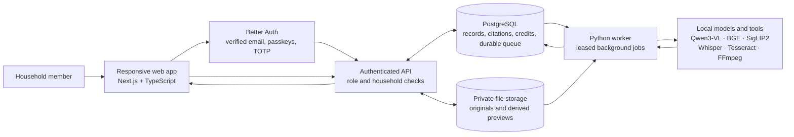
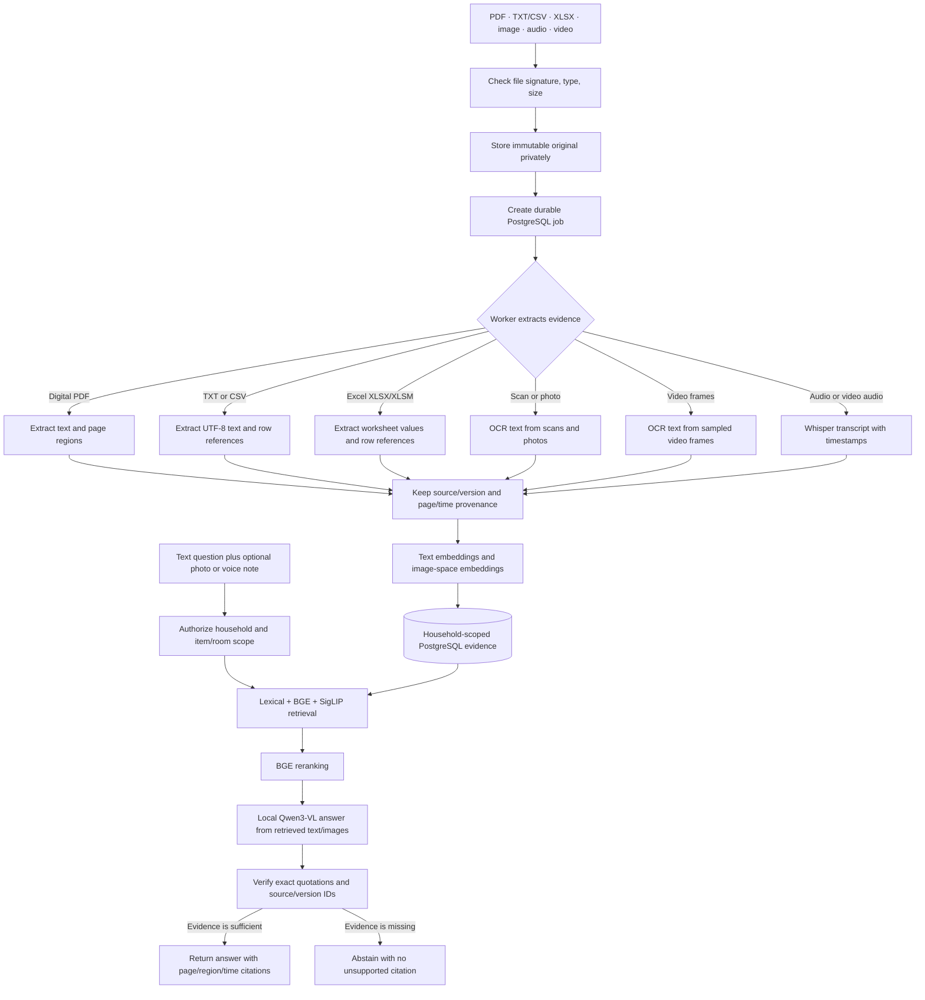

# HomeAtlas

**Your home, on the record.** HomeAtlas is a private household inventory and multimodal RAG app: keep manuals, receipts, photos, voice notes, and videos together, then ask questions and get answers grounded in your own records.

Built with Next.js and TypeScript, Better Auth, PostgreSQL, a Python ingestion/retrieval worker, and locally run AI models. The tested inference profile uses Ollama for Qwen3-VL and local BGE, SigLIP2, Whisper, and Tesseract components; household content is not sent to a hosted model API.


## What you can do

- **Ask about saved item details:** serial numbers, model, brand, purchase dates and warranty dates are read directly from the matching household inventory record. Identity-card spelling variants are normalized, and conflicting entries are shown explicitly.
- **Ask where an item is:** location questions check saved inventory and document locations directly, with links to the recorded room or drawer. Sample records are excluded from ordinary document retrieval.
- **Find records down to the drawer:** Home → Room → Zone → optional Container, full paths in searchable evidence, and direct answer links into the home view.
- **Design and explore your home:** data-driven isometric 3D, room zoom, clickable furniture, attached storage, and a grid-based floor-plan editor with doors/windows. [Upgrade guide and checks](docs/LOCATION_UPGRADE.md).

- **Keep a usable home inventory:** organize rooms and items, record brands, model and serial numbers, purchase dates, warranty dates, notes, and maintenance history.
- **Build a private record library:** upload PDFs, UTF-8 TXT/CSV, Excel `.xlsx`/`.xlsm`, common raster images, audio, and video; attach sources to a room or item; retain immutable source versions and processing status. Legacy `.xls` workbooks should be saved as `.xlsx` first.
- **Ask across modalities:** search manuals, receipts, scanned pages, photos, voice recordings, and sampled video frames. Answers link to exact PDF pages/regions or audio/video timestamps.
- **Get grounded answers:** combine lexical retrieval, BGE text embeddings, SigLIP2 image similarity, and reranking; Qwen3-VL drafts an evidence-based answer. Quotes and citations are verified, and the app abstains when it cannot find adequate evidence.
- **Manage a household together:** owner/editor/viewer roles, invitations, private bookmarks, saved searches, reminders, recurring tasks, and a household activity trail.
- **Keep access and operations accountable:** verified-email sign-in, passkeys, TOTP, session controls, household exports/deletion, and an auditable credit ledger.
- **Explore the home visually:** interactive 3D room/item view, keyboard controls, mobile layouts, reduced-motion behavior, and a WebGL fallback.

## Verified results

The 14 October hierarchy/layout regression run passed **83 JavaScript tests and 24 Python tests**, plus a live RAG-to-drawer browser flow, saved-answer links, hierarchy export, room/container navigation, saved layout edits, mobile width and WebGL fallback. These results and their limits are documented in the [location upgrade report](docs/LOCATION_UPGRADE.md). 120fps is a design target, not a measured claim.

These are local test and evaluation results recorded in the repository reports on 13 October 2026, not production service-level guarantees.

| Area | Recorded result |
| --- | --- |
| Backend and account/security suite | 57 tests passed |
| Python ingestion/retrieval worker | 17 tests passed |
| Expanded browser feature audit | 17 checks passed; zero browser exceptions |
| Live ingestion audit | 9 checks passed, including image and scanned-PDF OCR, retries, versions, citations, and credit reconciliation |
| Responsive design/accessibility QA | 142 checks passed across four viewport sizes; zero failures |
| Scoped multimodal RAG evaluation | 5/5 cases passed; supported-source recall 4/4, canonical citations 5/5, groundedness 5/5, missing-evidence abstention 1/1 |
| Audio/video pipeline | WAV, M4A, and MP4 reached ready; Whisper voice question returned timestamped citations |
| Inference safety examples | 2/2 local-model checks passed for embedded instructions and conflicting records |
| TypeScript, optimized build, npm audit | Passed; zero reported npm vulnerabilities |

The RAG evaluation is intentionally small (five clear English cases). It does not estimate broad accuracy, p95 latency, multilingual performance, arbitrary image-part matching, or production capacity. See [RAG evaluation limits](docs/RAG_EVALUATION.md#limits) and the [full verification report](docs/VERIFICATION.md).

## System architecture

The web application owns authentication, household authorization, APIs, and the UI. PostgreSQL stores household data and the durable job queue; originals and derived media stay in private filesystem storage. The Python worker processes queued sources and queries with local inference components.



## Multimodal ingestion and answer flow



## Main components

| Layer | Technology |
| --- | --- |
| Web UI and routes | Next.js 16, React, TypeScript |
| Authentication | Better Auth; verified email, passkeys, TOTP |
| Durable data and jobs | PostgreSQL; tenant-scoped relations, leased queue, credit ledger |
| Original/derived media | Private filesystem storage with authenticated, version-aware reads |
| Ingestion and retrieval | Python worker; PyMuPDF, Tesseract, Whisper, FFmpeg, lexical/vector retrieval |
| Local inference | Qwen3-VL 4B Instruct, BGE small + reranker, SigLIP2, Whisper tiny |
| Interactive home view | React Three Fiber, Three.js, Drei |

## Run HomeAtlas locally

The tested native setup needs Node.js 22.16+ (Node 26 tested), npm, Python 3.10–3.12 (3.12 tested), PostgreSQL 15 command-line tools, FFmpeg/FFprobe, Tesseract, and [Ollama](https://ollama.com/) for local model inference. The app and development database bind to loopback; do not expose this development configuration on a network.

1. Install the prerequisites above and start Ollama. If it is not already running, start its local service with `ollama serve` in a separate terminal.
2. Clone the repository and run setup from its root:

```sh
git clone https://github.com/RahulAdyaa/HomeAtlas.git
cd HomeAtlas
npm run setup
```

The setup initializes an isolated PostgreSQL database on port 54329, creates private local secrets in `.env.local`, installs locked JavaScript/Python dependencies, applies migrations, and starts the worker and web app. It preserves existing `.env.local` and database data on later runs. The first run downloads the official Satoshi webfonts if they are not present.

3. For full local neural retrieval, image understanding, and transcription, open a second terminal in the cloned repository and download the pinned model artifacts once:

```sh
cd HomeAtlas
bash scripts/models.sh
```

4. Open [http://localhost:3000](http://localhost:3000), create an account, and verify it with **Open verification email** on the local sign-in page. Then create a household and upload a record.

`npm run setup` remains in the foreground while the site is running; press Ctrl+C to stop it. PostgreSQL data persists between runs. Stop the owned database separately with `pg_ctl -D .data/postgres stop` when needed. Models use several GB of disk and memory; until they are installed, HomeAtlas does not call a hosted model and may use extractive answers or abstain. See [model details](docs/MODELS.md) for artifacts, licenses, and tested hardware.

### Development email

Registration requires verified email. In the local development setup, enter your account email and password on the sign-in form, then click **Open verification email**. The button checks your password and opens a fresh verification link for your own unverified account. It is available only in development on loopback, with `ALLOW_LOCAL_MAIL=true` and no SMTP configured; it is disabled in production. Verification/reset/invitation messages remain private JSON files in `.data/mail/`. Do not commit or expose this directory. To deliver real email, configure the SMTP variables from `.env.example`. `ALLOW_LOCAL_MAIL=true` allows local spool delivery during a production-build smoke test; real deployment must use SMTP and set it to false.

### Original test records

`tests/fixtures/` contains two clearly fictional, original CC0 AirOne appliance PDFs and a page scan. Upload these to an item to exercise the manual/receipt journey. They are not manuals or repair advice for any real appliance. `scripts/create-fixtures.py` reproduces them.

## Verification

```sh
npm run typecheck
node --env-file=.env.local --import tsx scripts/backend-migrate.ts
node --env-file=.env.local node_modules/vitest/vitest.mjs run
HOMEATLAS_DB_TESTS=1 worker/.venv/bin/python -m pytest tests/test_worker.py tests/test_worker_db.py
npm run build
node scripts/journey.mjs
node scripts/journey-mobile.mjs
npm run qa
node scripts/passkey-check.mjs
```

The design QA command uses the fictional account/session produced by the browser journey above and refreshes that fixture once before its app checks. It audits four viewports, both app themes, fonts, axe accessibility, keyboard access, placeholder labels, WebGL controls and motion states.

Browser checks require installed Playwright Chromium. Set `PLAYWRIGHT_EXECUTABLE_PATH` if using an existing compatible Chrome binary; otherwise run `npx playwright install chromium` and omit the override. Local browser scripts create isolated test accounts/households using original sample documents. Their credentials/session files go only into ignored `.data/`. They never email a real external recipient. The virtual-authenticator test exercises WebAuthn protocol, not physical-device syncing.

The latest full-site audit and fixes are in [FULL_SITE_AUDIT.md](docs/FULL_SITE_AUDIT.md). The repeatable expanded checks are `node scripts/feature-audit.mjs` and `node scripts/ingestion-audit.mjs`, after running the browser journey.

Detailed exercised results and remaining limitations are in [verification](docs/VERIFICATION.md), [security review](docs/SECURITY_REVIEW.md), and [RAG evaluation](docs/RAG_EVALUATION.md). Screenshots live in `docs/screenshots/`.

## Data and inference

Uploads are signature/type/size checked, stored as private immutable originals, queued in PostgreSQL, and processed asynchronously. UTF-8 text/CSV is indexed with row references; Excel `.xlsx`/`.xlsm` values are extracted without evaluating formulas and cited by worksheet/row; legacy `.xls` must be converted to `.xlsx`. PDFs retain page and region coordinates; Pillow-supported raster images are OCR'd and retain provenance; local Whisper produces timestamped audio/video segments; FFmpeg samples video frames. Citation opening always rechecks household membership and source/version IDs.

Retrieval filters by household and permissions before assembling candidates. Lexical and local text-vector search are fused/reranked; image vectors occupy a separate compatible space. Local Qwen produces evidence-reviewed explanations with verified quotations and supporting PDF page images. A second model pass reviews each section; see [detailed answers](docs/DETAILED_ANSWERS.md) for the limits of visual interpretation. Answers without adequate evidence abstain. Hazardous-work queries recommend a qualified professional.

Household owners manage membership, editors organize records, and viewers read/ask/save private bookmarks. No public file URLs exist. Application authorization and tenant foreign keys provide isolation; the application database role is a trusted service credential. A database-superuser or host compromise is outside that boundary.

Credits are internal allowances. The server reserves credits atomically before work and settles a charge/refund once; an append-only ledger records balance/reservation deltas. Prices and monthly grants are environment-configurable. There is no payment service.

## Architecture and operations

- [Architecture, data flow and checklist](docs/ARCHITECTURE.md)
- [Design language and screen requirements](design.md)
- [Design references and asset provenance](docs/DESIGN_REFERENCES.md)
- [Deployment, backup/restore and rollback](docs/DEPLOYMENT.md)
- [Progress and unresolved work](docs/PROGRESS.md)

Docker Compose is included. Copy `.env.example` to `.env`, replace every secret placeholder, and configure SMTP, then use `docker compose up --build`. PostgreSQL/worker stay on the private Compose network; only loopback port 3000 is published. Ollama runs on the host in this profile, and pinned HF artifacts are mounted read-only. Use an HTTPS reverse proxy for deployment. The current Docker runtime verification status is recorded in `docs/VERIFICATION.md`.

## Important implementation choices

The local profile uses a PostgreSQL durable queue with leased claims and atomic credit publication, private filesystem volumes, and household-bounded vector arrays. These make genuine development possible on the inspected 16 GiB Mac without requiring a Docker daemon, Redis, or MinIO. Queue claims use `FOR UPDATE SKIP LOCKED`; vectors are never mixed across model revisions or text/image spaces. Scale requires pgvector indexed search and object-storage integration; the Compose database image supports pgvector, but the current application does not claim to use ANN indexes or MinIO. See deployment limitations before sharing the service outside a single trusted host.

No paid or hosted model APIs, payment providers, third-party agent installers, or end-user agent tools are required.

### Hybrid retrieval and safe answer reuse

Text questions use **multilingual E5-small** embeddings (384 dimensions), **word BM25** candidates from PostgreSQL `tsvector`, and **3–4 character TF-IDF plus Damerau edit matching** candidates from `pg_trgm`/`fuzzystrmatch`. The three channels execute concurrently; weighted reciprocal rank fusion adds `weight / (k + rank)` for each unique chunk. Defaults: `k=60`, 30 results per channel, 5 final results. Explicit image questions retain SigLIP visual retrieval and page-neighbor evidence expansion. Saved inventory facts and locations still use the authenticated database lookup before document generation.

Edit [`config/retrieval.json`](config/retrieval.json) to tune channel weights, candidate counts, location boosts, thresholds, or the optional top-10 reranker. Larger `rrf_k` reduces rank-position differences; raise a channel's weight only after checking the evaluation set. [`config/search-aliases.json`](config/search-aliases.json) holds household/Indian-document aliases, applied to both queries and index text. After changing aliases, run migrations to rebuild the lexical index and restart the worker. Normalization uses NFKC, lowercase, punctuation removal and repeated-letter handling; digit strings are preserved. Explicit numeric terms must match, so a missing model/card number does not silently turn into a nearby number. Room names boost relevance; explicit UI room/item filters remain access-scoped filters. Low-score spelling suggestions are advisory only.

The lookup order for text questions is **exact cache → semantic cache → saved-record lookup / hybrid RAG**. PostgreSQL stores cache entries separately per household **and user**, including query scope, data version, citations, paths, expiry, and usage count. Semantic matches require cosine ≥0.93 **and** matching content terms, numbers and intent. Semantic embeddings remove request phrasing and permit unique one-edit spelling corrections; unmatched object/location terms remain a miss. Media queries bypass this text cache. Cached answers still pass authorization, version and citation checks before the app returns them.

Database triggers increment `households.data_version` for source, item, location and chunk mutations. Old generations are ignored; writes from an old in-flight generation are rejected. Defaults: 7-day TTL, 5-minute negative TTL, 500 entries per user/household, LRU eviction. Send `bypassCache: true` to `POST /api/ask` to force a fresh lookup (use a new `operationId`; idempotent replay still returns the original operation). Owners can use **Settings → Clear answer cache**, `DELETE /api/cache`, or inspect aggregate hit/latency metrics with `GET /api/cache`; pass the existing household selector/header. Live false-hit rate is unknown without labels; the API distinguishes guard rejections from measured false hits.

**Setup/update:** PostgreSQL needs `vector`, `pg_trgm`, and `fuzzystrmatch` extensions and ICU collation support. The supplied Compose database already uses `pgvector/pgvector:pg16`; native PostgreSQL installs need pgvector built for their installed PostgreSQL version. Run `node --env-file=.env.local --import tsx scripts/backend-migrate.ts`, then `worker/.venv/bin/python -m worker.download_models --text`. Remove any old `TEXT_EMBEDDING_MODEL` override or use the pinned E5 model/revision in `.env.example`, and restart the worker. Existing arrays are preserved; background migration rebuilds incompatible vectors with the current model. Lexical search remains available during rebuilding. Neural inference stays local.

**Measured results and limitations:** see [`evaluation/HYBRID_EVALUATION_REPORT.md`](evaluation/HYBRID_EVALUATION_REPORT.md) for all four channels, typo/identifier/no-match subsets, semantic-cache behavior and measured latency/LLM calls. This is a small fictional corpus, not a claim of perfect accuracy. PostgreSQL lexical shortlists use `ts_rank_cd` before BM25 rescoring over up to 120 candidates; fuzzy rescoring uses the same shortlist bound. Dense cosine search is exact within authorized records, without an ANN index. These choices suit household-sized collections; benchmark larger collections before changing bounds or adding ANN indexes.

Reproduce the comparison and checks:

```bash
worker/.venv/bin/python evaluation/hybrid_eval.py
HOMEATLAS_DB_TESTS=1 worker/.venv/bin/python -m pytest tests/test_worker.py tests/test_worker_db.py tests/test_hybrid_search.py tests/test_semantic_cache.py -q
npm test
node --env-file=.env.local scripts/hybrid-cache-qa.mjs
```

The evaluation and live API script create and remove fictional households. They never read personal document contents. The cache benchmark reports warmed-model timings separately from cache priming; existing credit/idempotency accounting is unchanged.

### Image evidence and OCR

Image and scanned-PDF uploads use bounded OCR passes for block/sparse layouts, rotation recovery, and installed English/Hindi packs. EXIF orientation and transparent backgrounds are handled consistently. Nearby labels and values are indexed together with line boxes and confidence metadata. PDFs with native headings also OCR up to eight substantial embedded image regions per page. A visual-only source receives a citable anchor rather than an empty chunk.

An auxiliary **SigLIP text-to-image channel** now searches image evidence for ordinary text questions as well as photo questions. It supplements the three hybrid text channels; similarity proposes candidates and does not establish correctness. The generator and independent reviewer receive the original source views (up to 2048 px), plus up to two bounded detail crops for small numbers. Unverified visual-only answers and low-confidence identifier fallbacks abstain. Very small text, blur, handwriting, skew and complex charts remain limitations.

See [`evaluation/IMAGE_PIPELINE_REPORT.md`](evaluation/IMAGE_PIPELINE_REPORT.md) for the measured OCR comparison and actual upload-to-answer checks. Reproduce with `python scripts/image-evidence-check.py`, `node --env-file=.env.local scripts/image-upload-qa.mjs`, and `python scripts/visual-grounding-check.py` using the worker virtual environment. The historical four-way hybrid comparison isolates the three text channels; its table does not include auxiliary visual retrieval. Existing ready PDF/image sources can be upgraded with `worker/.venv/bin/python scripts/reindex-image-sources.py HOUSEHOLD_UUID`; eligible already-paid jobs are reused, originals and historical citation rows remain, and no extra credit reservation is created.
