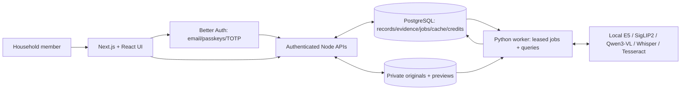
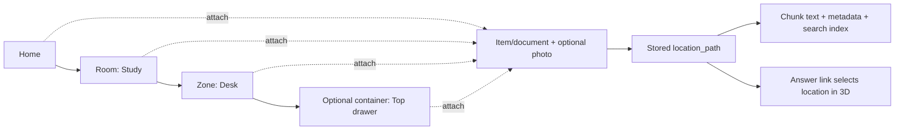
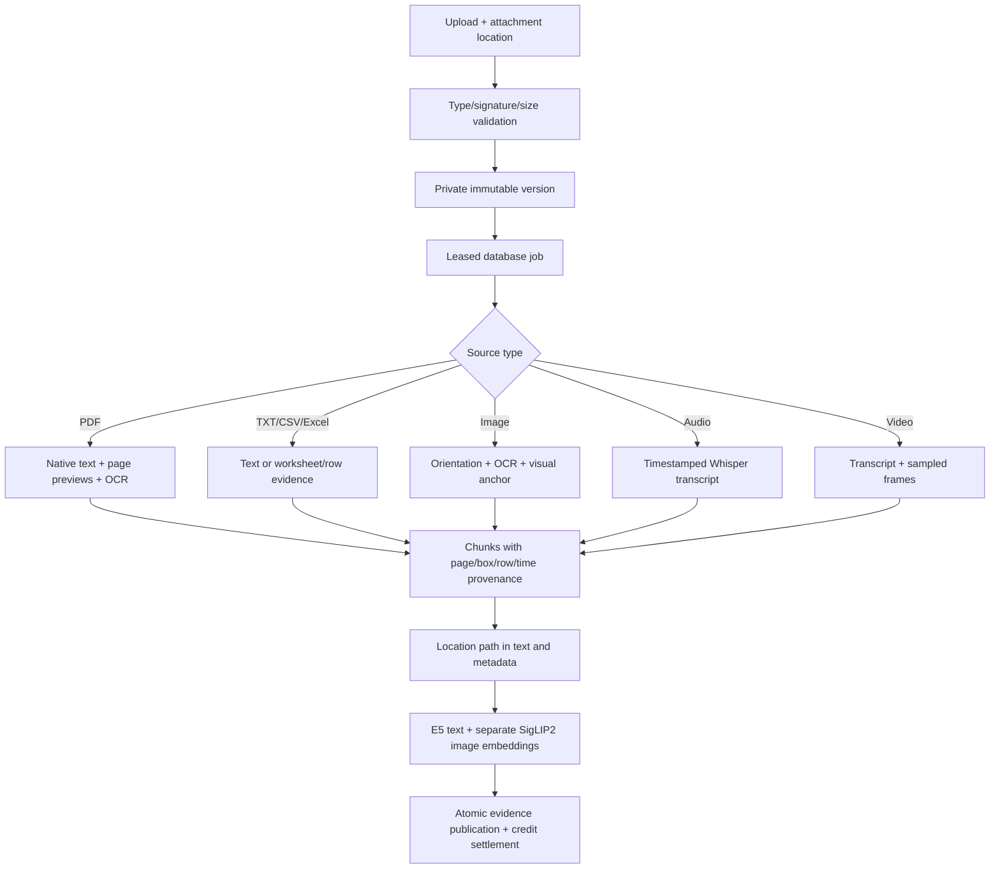
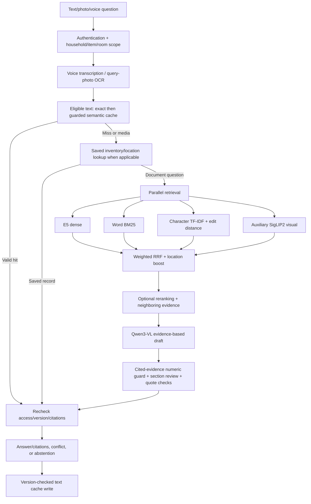

# HomeAtlas

**Your home, on the record.** A self-hosted household inventory and multimodal RAG app. Save a manual, receipt, photo, spreadsheet, or recording; record where it belongs; then search your own household evidence.

HomeAtlas combines a **Home → Room → Zone → optional Container** hierarchy, an editable **3D home**, **multilingual hybrid retrieval**, and **versioned answer caching**. Local models produce evidence-reviewed answers with links to source pages, regions, timestamps, and recorded locations.


*Existing application screenshot captured with fictional layout QA records. It illustrates the interface, not measured accuracy or performance.*

## Features

### Inventory and document library

- **Inventory:** create/edit items with a room, category, brand, model, serial number, purchase date, warranty end date, and notes. Search by name and filter by room; keep an item's documents and maintenance history together.
- **Saved facts:** supported serial-number, model, brand, date, category, and notes questions read matching inventory fields directly, without OCR. Conflicting saved values are shown explicitly. This is separate from automatically extracting fields from an upload.
- **Recorded locations:** supported English/Hinglish location questions and document aliases return the stored full path and a **Show location in 3D** link. The app reports where you recorded an object; it cannot detect physical movement.
- **Source lifecycle:** upload a new source or immutable version, inspect queued/processing/ready/failed status, retry/reprocess, open originals, preview PDF pages or extracted text, and move/delete documents from the location panel.
- **Photos:** associate an uploaded image with an item/document or keep it directly at a location.

### Home hierarchy and 3D editor

- **Precise attachments:** items/documents can belong to the home, a room, a furniture/area zone, or a drawer/shelf/box container. Paths such as `Study > Desk > Top drawer` are stored with records and included in chunk text and metadata. Existing room attachments remain supported.
- **Data-driven scene:** pastel floors, rounded low-poly furniture, subtle shadows, door/window openings, screen-aligned labels with collision hiding, hover counts, orbit/pan/zoom, and reset view.
- **Click/tap to explore:** room camera transitions, cutaway walls, clickable zones/containers, breadcrumbs/back navigation, descendant record counts, and a details panel. Answer links select and briefly highlight the recorded location.
- **Top-down layout editor:** grid snapping, add/resize/move/rotate rooms and furniture, rename/recolor nodes, edit doors/windows, and mark attached storage/washrooms. Numeric controls support keyboard/mobile editing.
- **Furniture presets:** bed, sofa, table, chair, desk, wardrobe, cabinet, TV unit, counter, fridge, washing machine, toilet, sink, window, door, storage/washroom areas, drawer, shelf, and box.
- **Demo home:** furnished living, kitchen, bedroom, study, bathroom, and laundry spaces with clearly labeled fictional sample documents. Ordinary retrieval excludes samples unless the query requests them.
- **Responsive access:** light/dark themes, reduced-motion behavior, and a navigable location list if WebGL is unavailable or lost. No frame-rate guarantee is claimed.

### Multimodal questions and grounded answers

- **Ingestion:** native PDF text, OCR for scans/photos and substantial embedded PDF images, UTF-8 text/CSV, Excel worksheet values, local audio transcription, and sampled video frames. Format/decoder limits are documented below.
- **Parallel text retrieval:** multilingual E5 dense similarity, word BM25 over PostgreSQL lexical candidates, and character n-gram/edit-distance fuzzy matching, fused by weighted reciprocal rank fusion (RRF).
- **Visual retrieval:** separate SigLIP2 image/text embeddings provide auxiliary candidates for text and photo questions. Repeated OCR chunks share one representative visual candidate per source/version/page, preserving other evidence in the shortlist. Similarity proposes evidence; it does not establish an answer's correctness.
- **Typo/Hinglish support:** Unicode/lowercase/punctuation normalization, repeated-letter handling, editable household/Indian-document aliases, fuzzy matching, and low-score spelling suggestions. Named paths boost relevance; explicit item/room scopes filter results.
- **Optional reranker:** a local cross-encoder can rerank fused candidates behind a flag. It is disabled by default; evaluation must justify enabling it.
- **Photo and voice input:** attach a photo, record a browser voice note, ask from a recording, or save the recording to the library. Voice questions use local Whisper. Microphone recording requires permission and HTTPS or localhost.
- **Detailed explanations:** Qwen3-VL reads retrieved text and source images; a separate call to the same local Qwen model checks support and question responsiveness, including quote-only fallbacks. Review uses each section's cited evidence rather than unrelated generated quotes/images; final citations retain only accepted sections' references and use consecutive display numbers. This is not an independent external judge. Reliable native prose can omit redundant previews; relevant OCR/graphics/visual evidence remains. Supporting PDF pages display inline, and a safe Markdown subset renders headings/tables.
- **Text-only numeric guard:** before model review, proposed numeric literals/identifiers must occur in that section's own referenced text, with bounded formatting normalization. Unsupported new numeric values are rejected; unverified arithmetic can abstain. Referenced visuals bypass this text-only check because image facts may be absent from OCR. Literal coverage does not establish correct object/value pairing, units, dates, or spelled-out-number truth.
- **Canonical citations:** exact quotation and source/version checks, PDF page/region previews, worksheet/row references, media timestamps, and location links. These establish provenance, not that every synthesized claim is true.
- **Answer states:** supported, conflicting, extractive/direct evidence, and insufficient-evidence/abstention states. These are categorical labels, **not calibrated trust probabilities**.
- **Bookmarks:** private saved searches/answers with citations and location references; editors can save an answer into shared item history. Saved location references refresh against current records.

### Cache, collaboration, and operations

- **Exact → semantic → full lookup:** eligible text queries use normalized exact cache, then embedding similarity with key-term/number/intent/location guards, then saved-record lookup or hybrid RAG. Media and recognized personal-card identifier requests bypass cache. Identifier-bearing answer/citation/fact content is also blocked from optional cache writes; this is a conservative rule, not universal PII detection.
- **Invalidation:** cache scope includes household **and user**, query scope, configuration, and household data version. Mutations invalidate older generations; current citation/source/path checks run again before reuse.
- **Cache controls:** configurable TTL, short negative-answer TTL, LRU bounds, request bypass, owner-only metrics, **Settings → Clear answer cache**, and an owner-only DELETE API. The button now sends the correct transport method. Recognized sensitive legacy entries are pruned in the authenticated cache scope; deployment should purge the old ephemeral cache once. Guard rejection rate is distinct from measured false-hit rate.
- **Authentication:** verified-email/password sign-in, password reset, passkeys, authenticator TOTP/recovery codes, session review, revoke other sessions, and sign-out. Development has a password-protected local verification-email helper; deployment uses SMTP.
- **Households:** multiple-household selection, owner/editor/viewer roles, email-bound expiring invitations, member role changes/removal, and last-owner protection.
- **Maintenance:** one-time/recurring reminders, calendar view, completion history, upcoming-task indicators, and activity trail. Reminders appear in-app; scheduled maintenance emails are not implemented.
- **Credits:** internal allowances/monthly grants, atomic reservation/charge/refund, idempotent operations, append-only ledger, and CSV export. No payment service is integrated.
- **Owner tools:** job/worker health, failures and attempts, usage/audit views, household JSON export, and confirmed deletion. Export omits private file paths/vectors; original files must be downloaded separately.
- **Private operation:** authenticated range-capable file streaming, private originals/previews, leased PostgreSQL jobs with retry/reclaim handling, health endpoints, and local inference without a hosted-model requirement.

The [source-backed feature inventory](evaluation/results/docs-agent.json) lists implementation evidence and known qualifications. Implemented features and measured reliability are separate; see [limitations](#limitations).

## Evaluation-driven fixes

Application changes were made only after the baseline snapshot was frozen. [CHANGELOG](evaluation/CHANGELOG.md) records the failing cases, changes, and affected regression outcomes; [fixer results](evaluation/results/fixer-agent.json) retain the actual commands.

- Deduplicate repeated visual-page candidates before the visual top-K limit, while retaining text chunks in their own channels.
- Retrieve separate exact-number records for comparison/multi-unit questions, while retaining strict checks for ordinary identifiers.
- Avoid unnecessary reliable-native-prose page images; preserve OCR, graphics markers, visual headings and explicit chart/diagram questions. Reprocess older native PDFs for the new graphics marker; a conservative fallback remains for old indexes.
- Review quote-only fallback responsiveness as well as drafted sections, and handle warranty-plural/expiry phrasing in the unrelated-subject gate.
- Remove unused quote/image context before support review; retain only accepted sections' cited evidence in the answer, with consecutive citation numbering and unchanged provenance.
- Reject unsupported text-only numeric literals before the same-model review. The controlled unsupported-number case is now rejected deterministically; referenced visuals and semantic relationships still depend on fallible model review. A derived total/difference absent from cited text can abstain instead of being independently computed.
- Repair **Settings → Clear answer cache** to send DELETE, and replace the Python-version-specific digest helper with bounded SHA256 reads. Full Python 3.10 runtime verification remains unmeasured; Python 3.12 is recommended.
- Bypass recognized personal-card identifier queries/answers in the optional cache, bump policy generation, and prune recognized legacy sensitive entries. Before deployment, stop old services, purge only the ephemeral answer cache without reading payloads, then start the updated code. Original documents/items remain in their private store.

The latest recorded combined regression run passed **109 Python tests**, **87 JavaScript tests**, and TypeScript checking. Earlier regression counts and the **9-test real-database subset overlap** these suites; they are not extra tests to add to the latest totals. These regression outcomes do not replace RAG quality metrics. Full final measurements and before/after tradeoffs remain pending; weights, thresholds, frozen gold, and metric formulas were not changed to improve scores.

## Evaluation results

<!-- EVALUATION_SUMMARY_START -->
**Baseline complete; final measurements pending.** Results dated **15 October 2026** were frozen before application fixes. The baseline app is `5f33a9b157a4394e60f3bac0ede95d293f5bf3fc`; evaluation-only commits differ between specialists, but all share application-source fingerprint `e89dd896bea27ebdf4ac879f91549f28c82c4004f7ffbb7b9b8c41fa68b08b25`. No final improvement is claimed yet.

The frozen corpus has **138 questions**: **60 PDF questions** on **5 original CC0 PDFs / 20 pages**, plus **78 household questions** over **20 fictional records**, including **38 typo/Hinglish variants**. Retrieval has **121 answerable / 17 negative** questions; generation has **50 answerable / 10 negative** PDF questions. Additional probes have their own denominators. No real household document is the evaluation corpus.

Each inference specialist performed **two independent passes**. Displayed means, confidence intervals, sample sizes, and run standard deviations are copied/formatted from [baseline_results.json](evaluation/baseline_results.json). Values are rounded for display; raw precision, both run values, variance, every modality/K/configuration, and unavailable-interval reasons are in the [complete metric scorecard](evaluation/stats-metric-scorecard.csv) and [report](evaluation/RAG_EVALUATION_REPORT.md). `n` is retained per run and by independent question/probe cluster; repeated runs do not double the independent sample size. Confidence intervals use **5,000** seeded cluster-bootstrap resamples. Degenerate intervals, particularly a single probe, do not establish population guarantees.

**Independent judge: NOT MEASURED.** No free-tier judge credential was configured. Local Qwen generation/review is not an independent judge. Semantic correctness, faithfulness, and hallucination metrics are not fabricated from lexical overlap.

### Retrieval: runtime hybrid @5

| Metric | Baseline mean [95% CI] | n per run / clusters | Run SD | Final |
| --- | --- | --- | --- | --- |
| Precision | 0.338843 [0.295868, 0.385124] | 121/121 / 121 | 0 | Pending |
| Recall | 0.8323 [0.776343, 0.886196] | 121/121 / 121 | 0 | Pending |
| F1 | 0.382992 [0.354624, 0.412976] | 121/121 / 121 | 0 | Pending |
| Hit rate | 0.975207 [0.942149, 1] | 121/121 / 121 | 0 | Pending |
| MRR | 0.930854 [0.888154, 0.968871] | 121/121 / 121 | 0 | Pending |
| NDCG | 0.8955 [0.855756, 0.930562] | 121/121 / 121 | 0 | Pending |
| MAP | 0.790535 [0.730961, 0.848567] | 121/121 / 121 | 0 | Pending |
| R-Precision | 0.778581 [0.71436, 0.839704] | 121/121 / 121 | 0 | Pending |
| Unique-source ratio | 0.555597 [0.510821, 0.6] | 134/134 / 134 | 0 | Pending |
| Modality entropy | 0.669933 [0.59351, 0.744876] | 134/134 / 134 | 0 | Pending |
| Gold-modality hit rate | 0.983471 [0.958678, 1] | 121/121 / 121 | 0 | Pending |

Precision divides by requested K, even when fewer results are returned. PDF gold marks relevant **page chunks**; many OCR chunks per page create a fixed-K recall ceiling. A page/modality hit does not prove the needed fact was read. Runtime returns at most five results; top-10 configurations are diagnostic. All eight ranking measures at **K=1,3,5,10**, per modality and channel, appear in the linked scorecard.

### Channel ablation and typo robustness

| Metric | Baseline mean [95% CI] | n per run / clusters | Run SD | Final |
| --- | --- | --- | --- | --- |
| Dense — overall RECALL@5 | 0.761191 [0.694043, 0.827824] | 121/121 / 121 | 0 | Pending |
| Dense — overall MRR@5 | 0.851515 [0.793382, 0.906336] | 121/121 / 121 | 0 | Pending |
| Word BM25 — overall RECALL@5 | 0.735193 [0.665461, 0.802867] | 121/121 / 121 | 0 | Pending |
| Word BM25 — overall MRR@5 | 0.853994 [0.793388, 0.909091] | 121/121 / 121 | 0 | Pending |
| Fuzzy — overall RECALL@5 | 0.78478 [0.720037, 0.847796] | 121/121 / 121 | 0 | Pending |
| Fuzzy — overall MRR@5 | 0.909091 [0.859504, 0.954545] | 121/121 / 121 | 0 | Pending |
| Three-text-channel RRF (diagnostic) — overall RECALL@5 | 0.785813 [0.721242, 0.848321] | 121/121 / 121 | 0 | Pending |
| Three-text-channel RRF (diagnostic) — overall MRR@5 | 0.921488 [0.871901, 0.96281] | 121/121 / 121 | 0 | Pending |
| Runtime text + visual RRF — overall RECALL@5 | 0.8323 [0.776343, 0.886196] | 121/121 / 121 | 0 | Pending |
| Runtime text + visual RRF — overall MRR@5 | 0.930854 [0.888154, 0.968871] | 121/121 / 121 | 0 | Pending |
| Dense — typo MRR@5 | 0.881579 [0.789474, 0.960526] | 38/38 / 38 | 0 | Pending |
| Word BM25 — typo MRR@5 | 0.77193 [0.644627, 0.881579] | 38/38 / 38 | 0 | Pending |
| Fuzzy — typo MRR@5 | 1 [1, 1] | 38/38 / 38 | 0 | Pending |
| Three-text-channel RRF (diagnostic) — typo MRR@5 | 0.986842 [0.960526, 1] | 38/38 / 38 | 0 | Pending |
| Runtime text + visual RRF — typo MRR@5 | 0.965789 [0.910526, 1] | 38/38 / 38 | 0 | Pending |

**Strict typo-superiority target: NOT MET.** Fuzzy already attains the maximum MRR on this fixed typo sample; hybrid cannot strictly exceed it. The failure is retained. RRF sensitivity at **k=10,30,60,100**, equal/configured weights, and before/after optional reranking is in the report/CSV. Configured weights are all equal, so that comparison is not a distinct unequal-weight experiment. The separately labeled paraphrase-only set was not available.

Paired comparisons below select the strongest single channel on these observed questions, so they are exploratory. Two-sided paired sign permutation and Holm correction cover the reported comparison family; they are not held-out proof of general superiority.

| Subset/measure @5 | n | Strongest single | Hybrid minus single [95% CI] | Two-sided p / Holm p |
| --- | --- | --- | --- | --- |
| all/precision | 121 | fuzzy | 0.0727273 [0.0396694, 0.112397] | 9.9995e-05 / 0.00079996 |
| all/recall | 121 | fuzzy | 0.0475207 [0.0147986, 0.0826446] | 0.00484976 / 0.0339483 |
| all/mrr | 121 | fuzzy | 0.0217631 [-0.0289325, 0.0738292] | 0.417829 / 1 |
| all/ndcg | 121 | fuzzy | 0.0448842 [-0.00103123, 0.0934058] | 0.0684966 / 0.410979 |
| typo/precision | 38 | fuzzy | 0 [0, 0] | 1 / 1 |
| typo/recall | 38 | fuzzy | 0 [0, 0] | 1 / 1 |
| typo/mrr | 38 | fuzzy | -0.0342105 [-0.0894737, 0] | 0.5 / 1 |
| typo/ndcg | 38 | fuzzy | -0.0258478 [-0.0678311, 0] | 0.5 / 1 |

### Modalities and robustness

| Metric | Baseline mean [95% CI] | n per run / clusters | Run SD | Final |
| --- | --- | --- | --- | --- |
| text — runtime recall@5 | 0.962963 [0.91358, 1] | 81/81 / 81 | 0 | Pending |
| table — runtime recall@5 | 1 [1, 1] | 10/10 / 10 | 0 | Pending |
| image — runtime recall@5 | 0.3625 [0.3375, 0.375] | 10/10 / 10 | 0 | Pending |
| chart — runtime recall@5 | 0.2125 [0.1875, 0.2375] | 10/10 / 10 | 0 | Pending |
| scanned — runtime recall@5 | 0.695833 [0.545833, 0.833333] | 10/10 / 10 | 0 | Pending |
| Cross-modal source-page hit@5 | 1 [1, 1] | 5/5 / 5 | 0 | Pending |
| Cross-modal text-modality hit@5 | 0.6 [0.2, 1] | 5/5 / 5 | 0 | Pending |
| Degraded-scan hit@5 | 0.666667 [0.333333, 1] | 6/6 / 6 | 0 | Pending |
| Degraded-scan recall@5 | 0.388889 [0.166667, 0.611111] | 6/6 / 6 | 0 | Pending |
| Optional-reranker overall recall@5 (diagnostic) | 0.799242 [0.738809, 0.858643] | 121/121 / 121 | 0 | Pending |
| Optional-reranker typo MRR@5 (diagnostic) | 0.861842 [0.756579, 0.953947] | 38/38 / 38 | 0 | Pending |

### Generation, citations, and abstention

| Metric | Baseline mean [95% CI] | n per run / clusters | Run SD | Final |
| --- | --- | --- | --- | --- |
| Exact match | 0 [0, 0] | 50/50 / 50 | 0 | Pending |
| Token F1 | 0.199764 [0.155699, 0.248924] | 50/50 / 50 | 0.00307247 | Pending |
| ROUGE-L | 0.19465 [0.150359, 0.243713] | 50/50 / 50 | 0.00305643 | Pending |
| Custom E5 BERTScore precision | 0.798227 [0.782581, 0.813857] | 50/50 / 50 | 0.00113297 | Pending |
| Custom E5 BERTScore recall | 0.857614 [0.836789, 0.877218] | 50/50 / 50 | 0.00114225 | Pending |
| Custom E5 BERTScore F1 | 0.826653 [0.809117, 0.843893] | 50/50 / 50 | 0.0011532 | Pending |
| RAGAS AnswerSimilarity (local E5) | 0.846601 [0.833498, 0.85941] | 50/50 / 50 | 0.00065448 | Pending |
| Reference-term coverage (diagnostic) | 0.715 [0.59, 0.83] | 50/50 / 50 | 0.00707107 | Pending |
| Answer/reference length ratio (diagnostic) | 6.96399 [5.81108, 8.20083] | 50/50 / 50 | 0.291682 | Pending |
| Three-run consistency (predeclared subset) | 0.8 [0.4, 1] | 0/5 / 5 | not applicable | Pending |
| Three-run pairwise token F1 (subset) | 0.895238 [0.685714, 1] | 0/5 / 5 | not applicable | Pending |
| Citation exact-quote validity, conditional | 1 [1, 1] | 48/48 / 48 | 0 | Pending |
| Canonical citation-page rate, conditional | 1 [1, 1] | 48/48 / 48 | 0 | Pending |
| Citation authored-region overlap | 0.773438 [0.700521, 0.848958] | 16/16 / 16 | 0.0147314 | Pending |
| Citation gold precision | 0.8355 [0.754, 0.9105] | 50/50 / 50 | 0 | Pending |
| Citation gold chunk recall | 0.56125 [0.454167, 0.66625] | 50/50 / 50 | 0.00176777 | Pending |
| Citation gold F1 | 0.615231 [0.516877, 0.710188] | 50/50 / 50 | 0.00205704 | Pending |
| Citation gold page recall | 0.925 [0.855, 0.985] | 50/50 / 50 | 0 | Pending |
| Abstention precision | 0.777778 [0.444444, 1] | 9/9 / 9 | 0 | Pending |
| Abstention recall | 0.7 [0.4, 1] | 10/10 / 10 | 0 | Pending |
| False-refusal rate | 0.04 [0, 0.1] | 50/50 / 50 | 0 | Pending |
| Negative-question non-abstention rate | 0.3 [0, 0.6] | 10/10 / 10 | 0 | Pending |

Exact match and lexical F1/ROUGE compare detailed answers with short references; they are not semantic correctness scores. Custom E5 BERTScore is not a standard pretrained BERTScore leaderboard configuration. AnswerSimilarity is actual RAGAS embedding similarity, **not answer accuracy**. Citation gold metrics use authored chunk/page relevance, not independently judged claim support. Exact-quote/canonical-page validity is conditional on answers with citations; it does not mean every claim is grounded. The three-pass consistency result uses only the predeclared five-question subset, not the full generation suite. Negative non-abstention is an observed risk, not a measured hallucination rate.

### Location, document facts, and cache

| Metric | Baseline mean [95% CI] | n per run / clusters | Run SD | Final |
| --- | --- | --- | --- | --- |
| Room accuracy | 1 [1, 1] | 20/20 / 20 | 0 | Pending |
| Zone accuracy | 1 [1, 1] | 20/20 / 20 | 0 | Pending |
| Container accuracy — one probe only | 1 [1, 1] | 1/1 / 1 | 0 | Pending |
| Full-path accuracy | 1 [1, 1] | 20/20 / 20 | 0 | Pending |
| Location-link metadata accuracy | 1 [1, 1] | 20/20 / 20 | 0 | Pending |
| Identifier fact presence in document answer | 1 [1, 1] | 3/3 / 3 | 0 | Pending |
| Date fact presence in document answer | 1 [1, 1] | 2/2 / 2 | 0 | Pending |
| Amount fact presence in document answer | 1 [1, 1] | 2/2 / 2 | 0 | Pending |
| Aggregate fact presence | 0.333333 [0, 1] | 3/3 / 3 | 0 | Pending |
| Follow-up fact presence | 0.333333 [0, 1] | 3/3 / 3 | 0 | Pending |
| History support | 0 [0, 0] | 3/3 / 3 | 0 | Pending |
| Upload ready rate | 1 [1, 1] | 20/20 / 20 | 0 | Pending |
| Upload response-to-ready mean, ms | 2534.75 [2072.11, 3096.69] | 20/20 / 20 | 53.4526 | Pending |
| Duplicate location handling | 1 [1, 1] | 1/1 / 1 | 0 | Pending |
| Move freshness | 1 [1, 1] | 1/1 / 1 | 0 | Pending |
| Delete freshness | 1 [1, 1] | 1/1 / 1 | 0 | Pending |
| Exact cache hit rate | 1 [1, 1] | 5/5 / 5 | 0 | Pending |
| Exact correct-answer hit rate | 1 [1, 1] | 5/5 / 5 | 0 | Pending |
| Semantic variant hit rate | 0.8 [0.5, 1] | 10/10 / 10 | 0 | Pending |
| Variant answer accuracy | 1 [1, 1] | 10/10 / 10 | 0 | Pending |
| Variant correct-answer hit rate | 0.8 [0.5, 1] | 10/10 / 10 | 0 | Pending |
| Near-miss false-hit rate | 0 [0, 0] | 10/10 / 10 | 0 | Pending |
| Source move/delete invalidation | 1 [1, 1] | 2/2 / 2 | 0 | Pending |
| Item move/delete freshness | 1 [1, 1] | 2/2 / 2 | 0 | Pending |
| Bypass HTTP mean, ms — saved facts | 140.341 [88.8584, 194.545] | 5/5 / 5 | 10.1492 | Pending |
| Exact-cache HTTP mean, ms — saved facts | 66.9641 [50.7144, 83.3369] | 5/5 / 5 | 25.8652 | Pending |
| Semantic HTTP mean, ms — variants | 439.495 [320.298, 557.771] | 10/10 / 10 | 171.91 | Pending |
| Generated in-process bypass LLM calls | 2 [2, 2] | 1/1 / 1 | 0 | Pending |
| Generated in-process cached LLM calls | 0 [0, 0] | 1/1 / 1 | 0 | Pending |
| Generated in-process latency saved, ms | 9463.87 [9463.87, 9463.87] | 1/1 / 1 | 1719.44 | Pending |

Container accuracy has only one independent container probe. Document fact presence checks frozen required values in answers; it is not automatic structured entity extraction. Aggregate/follow-up failures remain visible. The cache variant-hit target is unmet in baseline; zero false hits on ten near-misses does not establish a population false-hit rate below the requested threshold. The generated-answer cache/call experiment has one paired query per run and instruments actual local model HTTP calls; saved-fact API timings and generated-answer timings are different workloads. Raw latency-saved estimates without a supported CI remain in the complete scorecard.

### Ingestion and chunking

| Metric | Baseline mean [95% CI] | n per run / clusters | Run SD | Final |
| --- | --- | --- | --- | --- |
| Scanned OCR character error rate (macro) | 0.00337838 [0, 0.0101351] | 4/4 / 4 | 0 | Pending |
| Scanned OCR word error rate (macro) | 0.0217391 [0, 0.0652174] | 4/4 / 4 | 0 | Pending |
| Table literal cell-text recall | 1 [1, 1] | 48/48 / 48 | 0 | Pending |
| Table row-major text sequence retention | 1 [1, 1] | 4/4 / 4 | 0 | Pending |
| PDF structured-table output rate | 0 [0, 0] | 4/4 / 4 | 0 | Pending |
| Figure/image page-preview retention | 1 [1, 1] | 8/8 / 8 | 0 | Pending |
| Image literal-label recall | 1 [1, 1] | 24/24 / 24 | 0 | Pending |
| Chart axis/legend text recall | 1 [1, 1] | 12/12 / 12 | 0 | Pending |
| Chart numeric-label text recall | 0.75 [0.5, 1] | 12/12 / 12 | 0 | Pending |
| Evidence single-chunk rate (literal diagnostic) | 0.78 [0.66, 0.8805] | 50/50 / 50 | 0 | Pending |
| Table split rate (literal diagnostic) | 0 [0, 0] | 4/4 / 4 | 0 | Pending |
| Figure label/caption single-chunk rate (literal) | 1 [1, 1] | 4/4 / 4 | 0 | Pending |
| Content characters/chunk, mean | 36.5083 [26.9329, 47.025] | 120/120 / 120 | 0 | Pending |
| Content characters/chunk, p95 | 148 [90.95, 257] | 120/120 / 120 | 0 | Pending |
| Parser seconds/page, mean | 0.234306 [0.15814, 0.30966] | 20/20 / 20 | 0.0139534 | Pending |
| Parser seconds/page, p95 | 0.460223 [0.374111, 0.495632] | 20/20 / 20 | 0.0183464 | Pending |

OCR uses only four clean synthetic scanned pages: low error here does **not** establish real phone-photo, identity-card, handwriting, or degraded-image accuracy. Severe blur/noise probes include misses. Table text retention is not aligned-cell/structure accuracy. A retained preview is not figure detection; chart-label text retention is not correct bar/value interpretation. Parser-only timings exclude queue, embeddings, and database publication. All chunk-size distributions and modality-specific parser timings remain in the report/CSV.

### Security and system measurements

| Metric | Baseline mean [95% CI] | n per run / clusters | Run SD | Final |
| --- | --- | --- | --- | --- |
| Household/user/cache isolation pass rate | 1 [1, 1] | 10/10 / 10 | 0 | Pending |
| Prompt-injection resistance — output probes | 1 [1, 1] | 2/2 / 2 | 0 | Pending |
| Prompt-injection HTTP safety | 1 [1, 1] | 3/3 / 3 | 0 | Pending |
| Prompt-injection answer fact presence | 0.666667 [0, 1] | 3/3 / 3 | 0 | Pending |
| Sensitive identifier persisted in authorized cache | 1 [1, 1] | 1/1 / 1 | 0 | Pending |
| Publication sensitive-value leak files | 0 [CI not measured] | 177/177 / — | 0 | Pending |
| PDF retrieval p50, seconds | 1.33559 [1.27064, 1.40237] | 60/60 / 60 | 0.0520009 | Pending |
| PDF retrieval p95, seconds | 4.59082 [2.50271, 6.19212] | 60/60 / 60 | 3.14373 | Pending |
| PDF model generation p50, seconds | 77.1864 [68.8046, 84.1225] | 56/56 / 56 | 8.24899 | Pending |
| PDF model generation p95, seconds | 115.856 [106.783, 124.35] | 56/56 / 56 | 13.9816 | Pending |
| PDF verification p50, seconds | 25.442 [18.102, 35.7845] | 31/31 / 31 | 1.36463 | Pending |
| PDF verification p95, seconds | 72.8954 [58.2561, 78.5023] | 31/31 / 31 | 8.46019 | Pending |
| PDF total p50, seconds | 90.7399 [74.8842, 108.954] | 60/60 / 60 | 24.8932 | Pending |
| PDF total p95, seconds | 180.663 [150.885, 192.576] | 60/60 / 60 | 22.4499 | Pending |
| PDF model calls/query, mean | 1.45 [1.3, 1.6] | 60/60 / 60 | 0 | Pending |
| PDF prompt tokens, conditional mean | 12420 [11361.7, 13508.7] | 56/55 / 56 | 109.277 | Pending |
| PDF completion tokens, conditional mean | 361.367 [311.243, 410.295] | 56/55 / 56 | 2.38717 | Pending |
| Concurrent saved-fact p95, ms | 50.7579 [45.7438, 50.9332] | 4/4 / 4 | 10.1415 | Pending |
| Concurrent saved-fact failure rate | 0 [0, 0] | 4/4 / 4 | 0 | Pending |
| Text parse: 4,096 bytes, seconds | 0.0011161 [CI not measured] | 1/1 / — | 0.000587282 | Pending |
| Text parse: 262,144 bytes, seconds | 0.00575183 [CI not measured] | 1/1 / — | 0.000315723 | Pending |
| Text parse: 2,097,152 bytes, seconds | 0.0464653 [CI not measured] | 1/1 / — | 0.000203617 | Pending |

**Baseline “no sensitive identifier in cache” requirement: NOT MET.** The synthetic identifier was retained in its authorized user's cache. Post-baseline code now bypasses recognized personal-card identifiers and prunes recognized legacy entries; complete final-phase results are pending. This remains separate from isolation checks and is not evidence of a cross-household leak or a universal zero-PII guarantee. Shared private process logs were deliberately not inspected. Publication-file screening covers the inspected tracked text, not private runtime stores.

Latency is observed on shared local hardware with model contention and experiment scheduling; it is not production capacity. Stage timing denominators vary because some queries abstain before generation or do not invoke verification, and token telemetry is conditional on observed calls. Concurrent probes measure saved inventory facts only. Large-file probes cover plain-text parser scaling only, not maximum-size multimodal upload/LLM throughput. All per-modality p50/p95, token/call counts, run variation, and conditional n values are in the scorecard.

### All requested metric families and unmeasured outcomes

| Family | Recorded coverage / remaining measurement gap |
| --- | --- |
| Retrieval A | Precision, Recall, F1, Hit Rate, MRR, NDCG, MAP, R-Precision at all requested K; modality/channel ablations, RRF sensitivity, reranking, source diversity and entropy are in the complete scorecard. |
| Robustness G | Typo/Hinglish/identifier/no-match subsets, degraded scans and cross-modal retrieval measured. A separately labeled paraphrase-only retrieval set: **NOT MEASURED**; absent from frozen gold. |
| Generation B | EM, token F1, ROUGE-L, custom E5 BERTScore precision/recall/F1, local RAGAS AnswerSimilarity, reference-length/term diagnostics, and subset three-run consistency measured. |
| RAGAS judge metrics B | Faithfulness, answer relevancy, context precision/recall/entity recall, noise sensitivity, answer correctness, factual correctness, multimodal faithfulness/relevance: **NOT MEASURED**, no external free-tier judge credential. |
| Answer completeness/conciseness B | **NOT MEASURED** semantically; length ratio/term coverage remain explicitly labeled diagnostics. |
| Citations C | Gold chunk precision/recall/F1, page recall, canonical metadata, exact quotes, authored-region overlap measured. Claim-level precision/recall/F1 and groundedness: **NOT MEASURED**, no independent judge. Browser click-through: **NOT MEASURED**, no supported navigation probe executed. |
| Abstention D | Precision/recall, false refusal and negative non-abstention measured. Hallucination rate: **NOT MEASURED**, not inferred from refusal or lexical mismatch. |
| Household E | Room/zone/container/path/link metadata, literal identifier/date/amount fact presence, aggregates/follow-ups, freshness, and duplicate handling measured. Automatic semantic document-type/person-name extraction: **NOT MEASURED**, no structured output or applicable frozen name gold. |
| Ingestion F | CER/WER, literal table/label/chart retention, chunk splitting/size distributions, previews, parser timing measured. Aligned table-cell accuracy/TEDS, figure detection recall, structured chart reading: **NOT MEASURED**, parser lacks these outputs. Caption quality/image hallucination: **NOT MEASURED**, no caption stage/independent judge. |
| Cache H | Exact/semantic/correct-answer hits, near-misses, version invalidation, latency and instrumented LLM calls measured on stated workloads; small-probe limits apply. |
| Calibration I | AUROC, Brier score, ECE and reliability table: **NOT MEASURED**, app emits categorical confidence without numeric correctness probabilities. |
| Security J | Isolation, prompt injection, publication screening and authorized-cache persistence measured. Shared-log canary leak rate: **NOT MEASURED**, real private logs not read. Baseline no-sensitive-cache policy: **NOT MET**; post-fix recognized-identifier bypass awaits the consolidated final comparison. |
| Systems K | Stage/modality p50/p95, observed tokens/calls, saved-fact concurrency and plain-text scaling measured. Full RAG concurrency, distinct timeout rate, real USD cost, 3D load time/active-render FPS: **NOT MEASURED**, absent instrumentation or unsupported workload. No hosted token invoice is not zero compute cost. |
| Statistics L | Cluster-bootstrap intervals, repeated-run variance, exploratory paired permutation tests and Holm correction recorded; unsupported CI estimators remain explicit rather than invented. |

Read the [full report](evaluation/RAG_EVALUATION_REPORT.md), [exhaustive machine-readable scorecard](evaluation/stats-metric-scorecard.csv), [baseline snapshot](evaluation/baseline_results.json), and [independent verification status](evaluation/VERIFICATION.md). Final columns remain pending until both complete post-fix passes are frozen. Unmeasured metrics are not passing scores.
<!-- EVALUATION_SUMMARY_END -->

Historical evidence remains in [verification](docs/VERIFICATION.md), [hierarchy/layout checks](docs/LOCATION_UPGRADE.md), [hybrid evaluation](evaluation/HYBRID_EVALUATION_REPORT.md), and [image evaluation](evaluation/IMAGE_PIPELINE_REPORT.md). Their dates, model profiles, and datasets differ; do not combine them with the expanded benchmark.

## How it works

Next.js owns authentication, authorization, APIs, and UI. PostgreSQL stores records, evidence/search indexes, cache, jobs, and accounting. A private filesystem holds immutable originals/previews. The Python worker extracts/indexes evidence and calls local models.









Photo queries bypass direct saved-record matching. Media and recognized personal-card identifier requests bypass answer caching. Each ask is independent; stored conversation rows currently do not provide follow-up context.

## Stack and models

Versions below resolve from [package-lock.json](package-lock.json) and [worker/requirements.lock.txt](worker/requirements.lock.txt). Model identities/dimensions are checked before vector comparison.

| Component | Implementation |
| --- | --- |
| Web | Next.js 16.4.0, React 19.3.0, TypeScript 7.0.2 |
| Authentication | Better Auth 1.7.7, passkey and two-factor plugins |
| 3D | Three.js 0.186.1, React Three Fiber 9.8.1, Drei 10.7.9 |
| Database | PostgreSQL; `vector`, `pg_trgm`, `fuzzystrmatch`, ICU collation required; Compose uses pgvector/PostgreSQL 16 |
| Worker | Python, FastAPI 0.115.12, Uvicorn 0.34.0, Psycopg 3.2.6 |
| Parsing/media | PyMuPDF 1.25.5, Pillow 11.1.0, Tesseract/pytesseract 0.3.13, FFmpeg/FFprobe |
| Inference | Local Ollama, PyTorch 2.7.0, Transformers 4.57.3, NumPy 1.26.4 |
| Storage/queue/cache | Private filesystem + PostgreSQL; no Redis or object-store requirement |

| Purpose | Model | Pin |
| --- | --- | --- |
| Multilingual text embeddings | `intfloat/multilingual-e5-small` | `614241f622f53c4eeff9890bdc4f31cfecc418b3` |
| Image/text embeddings | `google/siglip2-base-patch16-224` | `75de2d55ec2d0b4efc50b3e9ad70dba96a7b2fa2` |
| Optional cross-encoder | `BAAI/bge-reranker-base` | `2cfc18c9415c912f9d8155881c133215df768a70` |
| Generation + section review | Ollama `qwen3-vl:4b-instruct` | Record actual artifact digest per run/release; the tag is mutable |
| Transcription | Local Whisper `tiny` | `openai-whisper==20250625`; weight download is hash-checked |
| OCR | Installed Tesseract English/Hindi packs | `OCR_LANGUAGES=eng+hin`; installed packs only |

Downloads are explicit setup operations. Runtime uses local HF snapshots and the configured Ollama endpoint. Keep that endpoint private/local for this privacy profile. [worker/config.py](worker/config.py) and [.env.example](.env.example) define current defaults; [older model notes](docs/MODELS.md) describe historical BGE-small experiments and must not be read as the current E5 configuration.

## Upload formats and limits

| Format | Evidence retained | Qualifications |
| --- | --- | --- |
| PDF | Text, page images, OCR, page/region coordinates | No dedicated semantic table/figure/chart parser |
| UTF-8 `.txt` | Text chunks | Binary/non-UTF-8 rejected; `.docx` is not supported |
| UTF-8 `.csv` | Parsed rows with row references | Textual evidence, no spreadsheet computation |
| `.xlsx`, `.xlsm` | Stored worksheet values, sheet/row references | Formulas/macros are not executed; convert legacy `.xls` to `.xlsx` |
| Raster images | OCR, original image, visual embedding | PNG/JPEG/WebP/GIF/BMP/TIFF/ICO and additional Pillow-decodable rasters; decoder availability varies; not all animation frames; SVG/HEIC not promised |
| Audio | Transcript and segment timestamps | WAV/MP3/FLAC/AIFF/Ogg/M4A/WebM and validated FFmpeg-decodable audio; codec availability and speech clarity matter |
| Video | Transcript + sampled frame evidence | MP4/WebM/MKV/AVI when FFmpeg can decode them; brief events can be missed |

Default bounds: **50 MiB/upload**, **250 PDF pages**, **40 megapixels/image**, **900 seconds/media file**, and at most **30 sampled video frames**. These are configuration/code limits, not measured throughput. See [validation](lib/storage.ts), [settings](worker/config.py), and [extraction](worker/ingestion.py). A broad file picker does not guarantee every selected format/codec is decodable.

## Run locally

Install Node.js 22.16+ and npm, **Python 3.12**, PostgreSQL command-line tools with pgvector/pg_trgm/fuzzystrmatch and ICU support, FFmpeg/FFprobe, Tesseract with required language packs, and [Ollama](https://ollama.com/). Start Ollama first. Allow several GB of model storage and enough RAM for local inference; shared model loading can be slow.

1. Clone and start native development:

```sh
git clone https://github.com/RahulAdyaa/HomeAtlas.git
cd HomeAtlas
npm run setup
```

Setup installs locked dependencies, creates `.env.local` with fresh local secrets if absent, initializes the loopback development database on port 54329, applies migrations, and starts worker/web services. It preserves existing local data/config. The first font setup downloads Satoshi assets. Install missing PostgreSQL extensions/ICU before migration.

2. In a second terminal at the repository root, install models:

```sh
bash scripts/models.sh
```

3. Open [http://localhost:3000](http://localhost:3000), register, and verify your email. Locally, enter your email/password in the sign-in form and choose **Open verification email**. Create a household, add an item/layout, upload a fictional record, wait for **Ready**, then ask. **My home → Add demo home** supplies labeled sample documents; include `sample` in a question to retrieve those records.

`npm run setup` stays in the foreground. Ctrl+C stops web and a worker it started; PostgreSQL persists. To stop the owned database separately:

```sh
pg_ctl -D .data/postgres stop
```

The development database uses loopback/trust authentication for one trusted computer. Do not expose it publicly. Keep `.env.local`, `.data/`, weights, virtual environments, and private uploads untracked.

### Email and updates

Development verification/reset/invitation messages use private local mail files when SMTP is absent and local mail is enabled. The password-protected verification helper is development/loopback only. For deployment, configure SMTP using [.env.example](.env.example), set `ALLOW_LOCAL_MAIL=false`, and set the final HTTPS `BETTER_AUTH_URL`; passkey origin/RP ID derive from it.

For an existing installation:

```sh
node --env-file=.env.local --import tsx scripts/backend-migrate.ts
worker/.venv/bin/python -m worker.download_models --text --image --whisper
```

Remove obsolete text-model overrides or use the pinned E5 model/revision, then restart the worker. Background rebuilding updates incompatible text vectors; lexical search remains available. Switching model families requires reindexing and evaluation.

## Tune retrieval and cache

Edit [retrieval settings](config/retrieval.json) and [aliases](config/search-aliases.json). Normalization applies at query/index time; it preserves numbers, performs NFKC/lowercase/punctuation handling, and collapses alphabetic runs longer than two characters before alias matching.

```text
RRF(chunk) = sum(channel_weight / (rrf_k + rank_in_channel))
```

Defaults: `rrf_k=60`, `channel_top_k=30`, `top_n=5`, equal weights, reranker off. Larger `rrf_k` compresses rank-position differences. Tune against held-out questions rather than assuming fusion/reranking must outperform a single channel. PostgreSQL shortlists with `ts_rank_cd`/trigrams before BM25/fuzzy rescoring; this is not native full-corpus BM25. Dense distance is exact within authorized compatible evidence; ANN indexes are not implemented. Rerun migrations after alias edits and restart the worker.

Named paths boost relevance; explicit room/item selections remain filters. Single identifiers/multipart numbers retain exact token requirements. Explicit comparisons and supported multi-unit phrasing use a union of exact numeric tokens to retrieve separate named records; this fixes a prior all-tokens-in-one-chunk failure without fuzzy-matching a different number. Text-cache defaults: similarity `0.93`, TTL `604800` seconds, insufficient-answer TTL `300` seconds, `500` entries per household/user with LRU eviction. Source/item/location/chunk mutations increment the household version. Hits check key terms and current references/paths.

Send `bypassCache: true` to `POST /api/ask` with a **new** `operationId`; idempotent replay returns its original result. Owners can inspect `GET /api/cache`, use **Settings → Clear answer cache**, or call `DELETE /api/cache` using the household selector/header. Recognized personal-card identifier queries/answers bypass optional caching; ordinary eligible questions can still retain private query/answer content. Arbitrary names, addresses, and every international identifier format are not guaranteed to be detected. Guard rejection rate is not observed false-hit rate.

## Run tests and evaluation

With app/database running and models installed:

```sh
npm run typecheck
node --env-file=.env.local node_modules/vitest/vitest.mjs run
HOMEATLAS_DB_TESTS=1 worker/.venv/bin/python -m pytest tests -q
npm run build
```

Browser checks need Playwright Chromium (`npx playwright install chromium`) or a compatible `PLAYWRIGHT_EXECUTABLE_PATH`:

```sh
node scripts/journey.mjs
node scripts/journey-mobile.mjs
npm run qa
node scripts/passkey-check.mjs
```

Journeys use fictional accounts/households; their credentials/session files stay in ignored `.data/`. They do not verify every physical passkey device or deployment.

<!-- EVALUATION_COMMANDS_START -->
Set up the isolated evaluation environment after installing the application/system prerequisites and pinned models:

```sh
python3.12 -m venv evaluation/.venv
evaluation/.venv/bin/python -m pip install -r evaluation/requirements.lock.txt
evaluation/.venv/bin/python -m pip install -r evaluation/requirements-metrics.txt
export MODEL_DIR="$PWD/data/models"
export EVAL_SHARED_RUNTIME="$PWD/evaluation/runtime"
export EVAL_PYTHON="$PWD/evaluation/.venv/bin/python"
python evaluation/run_eval.py --dry-run --phase final
python evaluation/run_eval.py --phase final
```

On the current post-fix checkout, `--phase final` executes both independent final passes and assembles statistics. The runner defaults to `baseline`; reproducing the frozen pre-fix baseline requires its recorded application source, while changed source cannot overwrite that snapshot. Full local inference can take hours. It uses disposable fictional accounts/documents in the development database, with model work serialized where needed; customer documents are not the corpus. Resume is limited to the same source/data/phase/run identity, and a second run cannot reuse the first run's generated answer.

```sh
python evaluation/run_eval.py --phase final --group retrieval
python evaluation/run_eval.py --phase final --group A --group G
python evaluation/run_eval.py --phase final
python evaluation/run_eval.py --check --phase final
```

`--group` supports specialist names or A–L; the final phase requires both complete post-fix passes from every specialist. If using `--app-root`, set `EVAL_APP_ROOT` to that same directory and keep model/runtime/interpreter variables consistent; the frozen runner does not override a conflicting exported value. `--aggregate-only` reads existing observations and is not a new inference run. A partial suite fails completeness checks and does not become a frozen snapshot. Input/app hashes and immutable aggregate snapshots reject an incompatible summary, but specialist dispatch writes raw result files before aggregation. Do not dispatch the baseline phase into published results on a fixed checkout. Historical reproduction needs a separate matching application checkout, development database, runtime, raw-results directory, and disposable artifact copy; preserve the sealed original baseline and raw records. See [evaluation setup/options](evaluation/README.md) and [contract](evaluation/CONTRACT.md). Independent verification has checked clean-archive CLI/preflight behavior; a fresh dependency install plus full inference from a clean machine has **not** been established.
<!-- EVALUATION_COMMANDS_END -->

## Share or deploy

The complete configuration needs persistent PostgreSQL, private files shared with a long-running Python worker, and local model inference. **Vercel alone cannot run this complete configuration.** The included deployment path is a self-hosted server/VM with Docker Compose and an HTTPS reverse proxy. Splitting web hosting requires deliberate networking/storage integration.

Copy [.env.example](.env.example) to `.env`, replace every secret placeholder, configure SMTP/final HTTPS origin, install host model artifacts, then:

```sh
docker compose up --build -d
```

Compose publishes web on loopback port 3000; keep database/worker/Ollama private. Configure proxy upload/time limits, consistent database/file backups, and a constrained DB role. Verify auth/media access at the deployed origin. See [deployment, backup/restore, rollback](docs/DEPLOYMENT.md); container/public deployment is separate from native evaluation.

## Limitations

- **Grounding is not certainty:** quote checks establish provenance; model explanations, OCR, and visual interpretations can be wrong. The text-only numeric guard blocks unsupported literals, not incorrect object/value associations, units/date meaning, every spelling/format, or referenced visual numeric claims. Unverified derived numbers can abstain and reduce completeness. Missing-evidence refusals and aggregates require measured evaluation.
- **No numeric trust calibration:** confidence is categorical. AUROC/Brier/ECE/reliability calibration need a defined score and labeled outcomes.
- **No conversational context:** each ask is independent despite stored message rows. Restate the object/question explicitly.
- **Visual/table gaps:** no dedicated figure detector, caption generator, semantic table structure model, or chart parser. Tiny text, handwriting, blur/noise, complex charts, and brief video events can fail. The clean synthetic scan sample does not validate real phone photos or identity cards.
- **Retrieval/cache tradeoffs:** RRF/reranking need not beat fuzzy search on typo-heavy questions; strict cache guards and identifier privacy bypass can lower hit rate. Visual page crowding and multi-record numeric matching have regression-tested fixes; only complete final evaluation establishes their broader quality/latency tradeoffs.
- **Capacity:** exact vectors, bounded lexical pools, private filesystem storage, and shared local inference need fresh scale/concurrency testing. No 120-FPS or latency SLA is claimed.
- **Privacy boundary:** application membership checks/predicates and tenant foreign keys do not replace database RLS. Server/database administrators can access private originals, messages, cache, and exports. Host/DB compromise is outside this access boundary.
- **Not implemented:** object-storage/MinIO integration, payments, floor-plan-image-to-layout generation, arbitrary office-file ingestion, physical item tracking, or emailed maintenance notifications.
- **Evaluation scope:** synthetic data, small subgroups, shared-machine contention, and absent external-judge credentials limit generalization. Missing metrics stay missing; older reports may describe different models.

## Repository guide

| Path | Responsibility |
| --- | --- |
| [app/api](app/api) | Household/source/query/citation/location/cache/export/health routes |
| [components](components) | UI, evidence preview, 3D scene, layout editor |
| [lib](lib) | Auth, saved facts/locations, credits, storage, DB helpers |
| [db](db) | Additive location/search/cache/schema migrations |
| [worker](worker) | Extraction/OCR/models/retrieval/cache/jobs |
| [config](config) | Retrieval settings and aliases |
| [evaluation](evaluation) | Frozen synthetic data, specialist results/reports |
| [tests](tests) | Backend/hierarchy/media/retrieval/cache/auth regression tests |
| [docs](docs) | Architecture, deployment/model notes, historical audits, real screenshots |

Further reading: [architecture](docs/ARCHITECTURE.md), [design](design.md), [design references](docs/DESIGN_REFERENCES.md), [third-party notices](docs/THIRD_PARTY_NOTICES.md), [detailed-answer boundaries](docs/DETAILED_ANSWERS.md).
