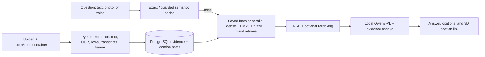

# HomeAtlas

**Find what you own, where you put it, and the record that proves it.** HomeAtlas is a self-hosted household inventory and multimodal RAG app. Save documents, photos, spreadsheets, and recordings; place them in a **Home → Room → Zone → Container** hierarchy; then ask questions and open the cited source or its location in an editable 3D home.


*Interface screenshot with fictional records; it is not a performance result.*

## What it does

- **Organizes your home:** track items, serial numbers, warranties, notes, documents, and precise locations. Edit the top-down layout or explore rooms, furniture, and containers in 3D; a 2D list is available without WebGL.
- **Accepts multiple formats:** PDF, UTF-8 TXT/CSV, XLSX/XLSM, raster images, audio, and supported video. Ingestion keeps page, row, region, or timestamp references where available. See [format limits](#supported-files).
- **Searches beyond embeddings:** multilingual E5 dense retrieval, word BM25, typo-tolerant fuzzy retrieval, and auxiliary SigLIP2 visual retrieval feed weighted reciprocal rank fusion (RRF). Location paths and aliases improve matches for questions such as “aadhar kahan hai”.
- **Answers from evidence:** Qwen3-VL uses retrieved text and source images. Answers link to original files and recorded 3D locations, show conflicts, and abstain when evidence is insufficient. Saved inventory fields can answer supported serial-number and location questions directly.
- **Protects household data:** verified sign-in, passkeys/TOTP, household roles, private file storage, local inference, and household/user-scoped exact and guarded semantic caches with version-based invalidation.

## Measured results

These are **synthetic, budget-limited checks**, not production accuracy claims. Retrieval and ingestion figures used two post-fix passes. Answer review covers only the first **43 of 60** planned generation questions (37 answerable, 6 negative), with no scanned-PDF answer cases or second generation pass. The independent Codex review uses a **0 / 0.5 / 1** rubric; its means are not binary accuracy percentages.

| Measure | Result | Scope |
| --- | ---: | --- |
| Retrieval coverage @5 | **98.35%** | 121 answerable questions; relevant page/chunk hit, not answer accuracy |
| Strict chunk Recall@5 | **80.49%** | 121 questions; declined from 83.23% baseline |
| Recorded full location path | **20/20** | Synthetic location questions; only one container case |
| Answer correctness / faithfulness | **0.824 / 0.972** | 37 answerable / 36 substantive saved answers; bounded independent review |
| Citation precision | **0.937** | 37 answerable questions; gold-source provenance, not proof of every claim |
| OCR character error rate | **0.34%** | Four clean synthetic scan pages; not real phone photos |
| Observed p95 query time | **162.6 s** | 43 saved queries on a shared host; not HTTP latency or an SLA |

**Trade-offs matter:** retrieval Precision fell **0.339 → 0.288** and strict Recall@5 fell **0.832 → 0.805** despite better coverage. On 38 typo/Hinglish questions, hybrid MRR@5 was **0.966** versus **1.000** for fuzzy-only search. Image-answer correctness averaged **0.65** (10 questions); chart answers averaged **0.714** (7). The complete benchmark, formal RAGAS judging, scanned-PDF answers, and production cost were **not measured**.

[Full evaluation report](evaluation/RAG_EVALUATION_REPORT.md) · [Independent answer review](evaluation/INDEPENDENT_JUDGE_REVIEW.md) · [Machine-readable results](evaluation/showcase_results.json)

## How it works



The Next.js app handles UI, authentication, and APIs; a Python worker processes media and queries. PostgreSQL stores household records, evidence, jobs, and cache; originals remain on a private filesystem. Each question is independent—follow-up conversational context is not implemented. [Architecture details](docs/ARCHITECTURE.md) · [Retrieval settings](config/retrieval.json) · [Editable aliases](config/search-aliases.json)

## Stack and models

| Layer | Technology |
| --- | --- |
| Web and 3D | Next.js, React, TypeScript, Three.js, React Three Fiber, Drei |
| API and worker | Next.js APIs, Python, FastAPI, Psycopg |
| Data | PostgreSQL 16 with pgvector, `pg_trgm`, `fuzzystrmatch`; private filesystem |
| Media | PyMuPDF, Pillow, Tesseract (English/Hindi), FFmpeg |
| Local models | `intfloat/multilingual-e5-small` (text embeddings), `google/siglip2-base-patch16-224` (visual embeddings), Whisper tiny (speech), Ollama `qwen3-vl:4b-instruct` (generation/review) |

The `BAAI/bge-reranker-base` cross-encoder is **optional and off by default**. Model revisions and package versions are pinned in [.env.example](.env.example), [package-lock.json](package-lock.json), and [worker/requirements.lock.txt](worker/requirements.lock.txt); the Ollama tag itself is mutable.

## Supported files

| Input | What HomeAtlas indexes |
| --- | --- |
| PDF | Native text, OCR/page previews, page and region references |
| TXT / CSV | UTF-8 text or row-level evidence |
| XLSX / XLSM | Stored worksheet values and sheet/row references; formulas/macros are not run |
| Images | Pillow-decodable rasters such as PNG, JPEG, WebP, GIF, BMP, TIFF; OCR and visual embedding |
| Audio / video | FFmpeg-decodable audio transcripts; video transcript and up to 30 sampled frames |

Default limits: **50 MiB/file, 250 PDF pages, 40 megapixels/image, 900 seconds/media**. Legacy XLS, DOCX, SVG, and HEIC are not promised. See [validation](lib/storage.ts) and [extraction](worker/ingestion.py).

## Run locally

Requires **Node.js 22.16+**, **Python 3.12**, PostgreSQL tools/extensions (`vector`, `pg_trgm`, `fuzzystrmatch`, ICU), **Ollama**, **FFmpeg**, and **Tesseract**. Allow several GB for local models. Start Ollama, then:

```sh
git clone https://github.com/RahulAdyaa/HomeAtlas.git
cd HomeAtlas
npm run setup
```

In another terminal, run `bash scripts/models.sh`. Open [localhost:3000](http://localhost:3000), register, use **Open verification email** in the local sign-in flow, create a household, and upload a fictional test record. Wait for **Ready** before asking. **My home → Add demo home** provides labeled sample records; include `sample` in questions about them. `npm run setup` starts the web app, worker, and a loopback development database; Ctrl+C stops web/worker. Keep `.env.local`, `.data/`, model weights, and private uploads out of Git. [Deployment guide](docs/DEPLOYMENT.md) explains HTTPS, SMTP, backups, and Docker Compose; **Vercel alone cannot host the complete local-worker/database configuration**.

## Verify and reproduce

With the app/database running and models installed:

```sh
npm run typecheck
node --env-file=.env.local node_modules/vitest/vitest.mjs run
HOMEATLAS_DB_TESTS=1 worker/.venv/bin/python -m pytest tests -q
npm run build
```

Browser journeys live in `scripts/journey*.mjs`. To rebuild the **existing** saved-results summary without new inference, run:

```sh
evaluation/.venv/bin/python evaluation/showcase/report.py --app-root "$PWD"
```

For evaluation setup, full-run commands, metric definitions, and missing measurements, use [evaluation/README.md](evaluation/README.md) and the [evaluation report](evaluation/RAG_EVALUATION_REPORT.md). A complete two-pass final generation benchmark has not been run.

## Current boundaries

OCR and vision can misread images; citations prove provenance, not every generated claim. There is no dedicated chart parser, semantic table-structure model, physical object tracking, or guaranteed frame rate. The local development database uses loopback/trust authentication and must not be exposed publicly. Details: [limitations and measured gaps](evaluation/RAG_EVALUATION_REPORT.md) · [deployment security](docs/DEPLOYMENT.md).
