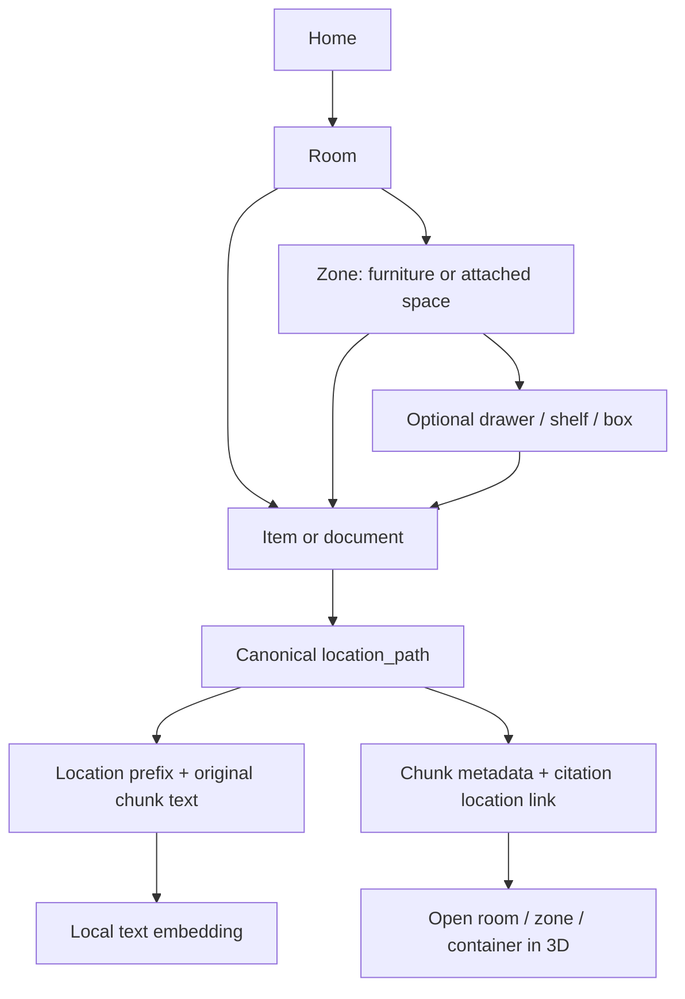
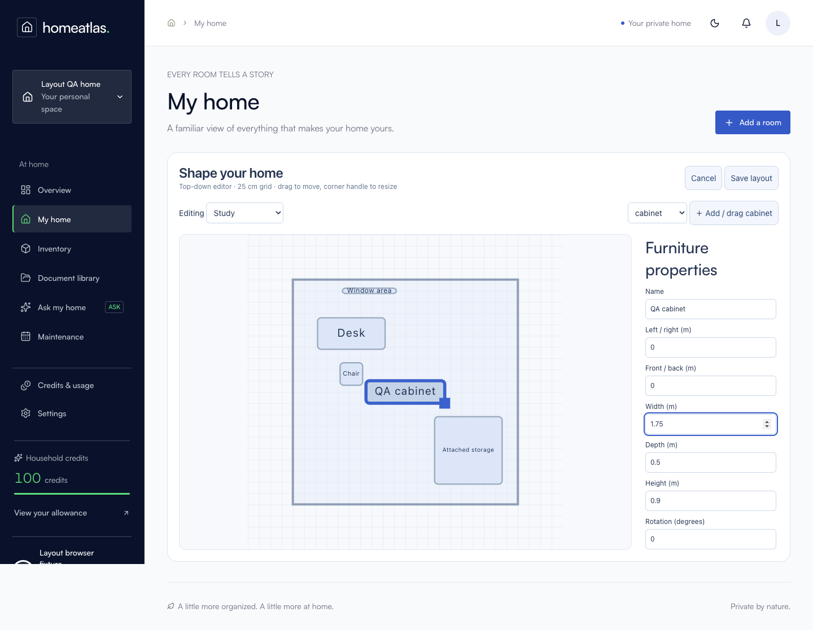

# Location and 3D home upgrade

Implemented 14 October 2026. This extends the existing PostgreSQL, Next.js, R3F/drei and Python worker stack.


## Data and retrieval



`002_locations.sql` backfills room nodes using the existing room UUIDs. It does not move existing room attachments. Tenant-scoped foreign keys and parent-type constraints enforce the hierarchy. The home node is also a valid attachment for previously unassigned records. Changes to ancestor names/parents refresh descendant paths. Original chunk content is retained in `metadata.content_text`; the location prefix is included before embedding. Moves clear stale vectors and mark them for asynchronous rebuilding. Lexical retrieval remains available while this runs. The worker uses a compare-and-swap when publishing refreshed embeddings, and checks attachment changes again before publishing ingestion results. Historical citations remain addressable. Saved answers retain canonical citation metadata and refresh their location navigation against the current household source list. Deleted sources are marked as removed, and stale evidence buttons are disabled. Export format version 2 includes all location nodes and their layout data.

`003_location_photos.sql` adds optional household-scoped photo references to documents and items. Upload a photo to the location, then choose it from the record's Photo selector. Removing that image clears its photo references.

`004_bookmark_locations.sql` preserves structured inventory/document location matches in saved answers. Questions such as “Where is my PAN card?” first match the item's saved name and current location (case and punctuation insensitive), without requiring an uploaded source or model inference. Duplicate names return all matching locations. Unknown identities continue through document RAG; SAMPLE fixtures are excluded before inference unless the question explicitly asks about sample/demo records. Non-location questions retain the existing multimodal retrieval pipeline.

Saved-field questions also check the inventory before calling document RAG. The server-owned field allowlist covers serial number, model, make/brand, purchase date, warranty end date, category and notes. Values are preserved as strings, including leading zeros and spacing. Common Aadhaar/Aadhar spellings and optional identity-card suffixes map to the same record name. Missing fields continue to document retrieval; different values in duplicate records produce an explicit conflict. The existing household/item/room scope and credit reservation rules still apply. `scripts/item-facts-qa.mjs` exercises the running authenticated HTTP routes with disposable fictional data, without requiring a document upload.

## Using the interface

1. Open **My home**. Orbit by dragging, zoom by scrolling/pinching, pan with the orbit controls, or use **Reset view**.
2. Click a room for an approximately 800ms camera transition and cutaway walls. Reduced-motion preference skips the animation.
3. Choose a zone or container. The side panel lists nested locations, documents/photos, and items. You can rename, move, upload, or delete documents, and delete empty locations. Viewers cannot edit.
4. Use **Edit floor plan** to drag room/furniture blocks on a 25cm grid. The corner handle resizes; numeric fields provide keyboard/mobile access. Choose a room to add furniture, and select a room to edit its wall openings. **Save layout** commits the entire batch transactionally and regenerates the scene. Cancel discards unsaved changes.
5. Use **Add demo home** once for six furnished rooms and four SAMPLE records. It is idempotent, preserves existing records, and reuses empty starter rooms. Only exact `home1` and `room2` test labels are renamed. Attached storage is represented as a zone with a doorway.

The scene uses low-poly primitives, capped device pixel ratio, on-demand rendering, bounded zoom and polar angles, and HTML labels hidden when they overlap or leave the viewport. The selected container label has priority. All locations remain accessible in the adjacent list and in the WebGL fallback. A stable overlay portal avoids label cleanup errors when switching views.



## Running / migrating

With the existing dependencies and local database running:

```sh
node --env-file=.env.local --import tsx scripts/backend-migrate.ts
# Separate terminals:
npm run dev
worker/.venv/bin/python -m uvicorn worker.app:app --host 127.0.0.1 --port 8001
```

The normal `npm run setup` workflow also runs the migrations. An optional local administrative seed is available:

```sh
node --env-file=.env.local --import tsx scripts/seed-demo.ts HOUSEHOLD_UUID
```

## Verification

- 83 JavaScript tests passed, including real PostgreSQL migration/backfill, tenant and role guards, hierarchy CRUD, atomic layout rollback, idempotent seed, photo links, source deletion, saved-answer location refresh, hierarchy exports, inventory-only location lookup/moves/duplicate names, billing replay, saved item-field answers, spelling variants, exact-value preservation, missing/conflicting fields and existing authentication/credit/upload tests.
- 24 Python tests passed, including database ingestion/credit invariants and assertions that location paths are present at embedding time and refreshed after renames, plus demo exclusion before inference.
- Browser fixture: a live RAG location question, its saved answer opening the correct drawer, hierarchy export, rendered 3D, collision-free visible labels, room/container navigation, deep-link reload, saved furniture resize, 390px mobile overflow, WebGL fallback, and no uncaught page exceptions.
- Typecheck and production build checked separately.

Reproduce with `npm test`, `HOMEATLAS_DB_TESTS=1 worker/.venv/bin/python -m pytest tests/test_worker.py tests/test_worker_db.py -q`, and `node --env-file=.env.local scripts/location-qa.mjs` while the web app runs. Test files run sequentially because migration replay changes the shared PostgreSQL schema; concurrency assertions inside each test still run in parallel. Browser fixtures use a disposable account/household and clean up their records and files. Screenshots go to `/tmp/homeatlas-location-qa`.

Performance depends on GPU, screen refresh rate and layout complexity. **120fps is a target, not a measured guarantee.** No heavy imported models or continuous idle rendering are used. The editor is a manual layout tool; floor-plan image reconstruction is not implemented.
